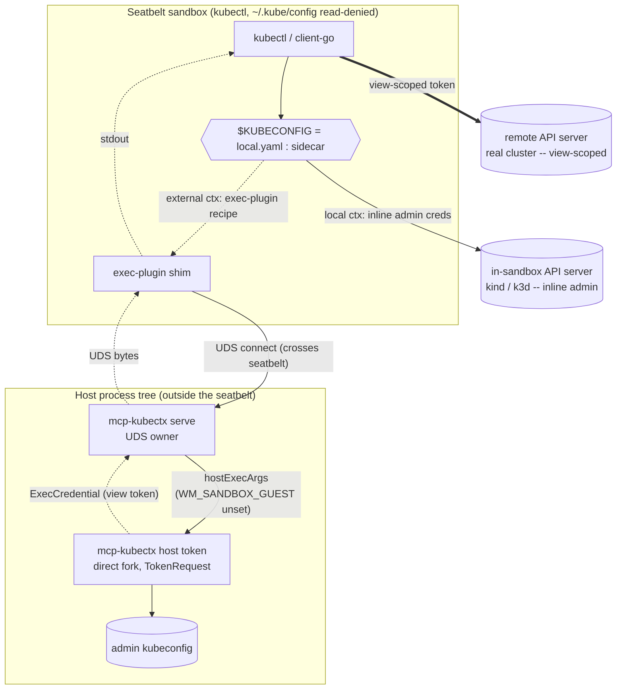
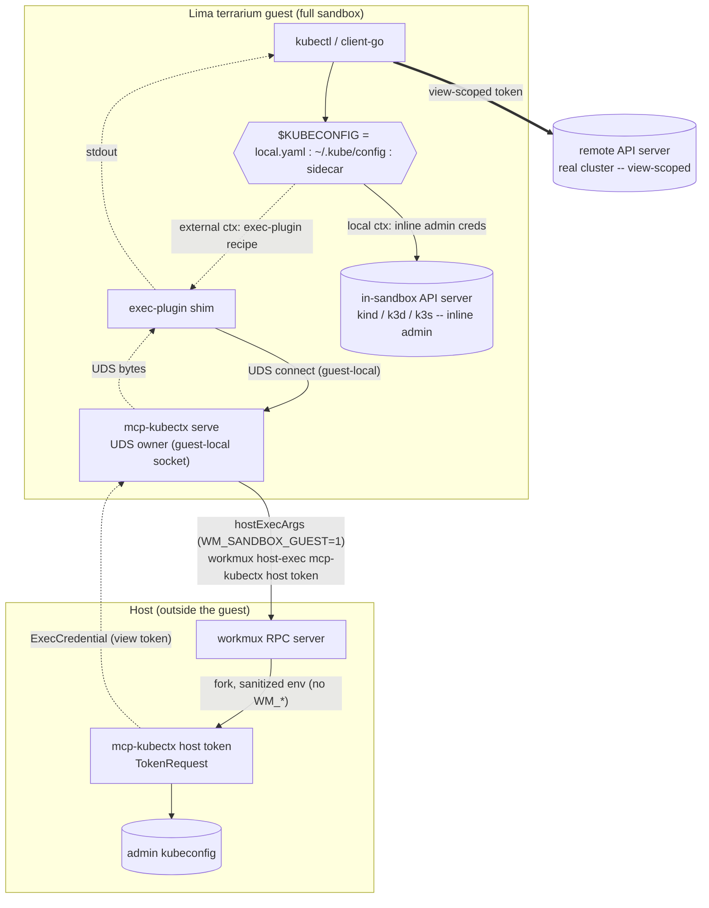

# mcp-kubectx

Cross-VM transport for Kubernetes context selection. A sandboxed
Claude (typically running inside a Lima guest) needs to use `kubectl`
without the host's admin kubeconfig leaking into the guest's
filesystem. The kubeconfig the guest consumes carries no token
material. It holds only a recipe (a kubectl exec auth plugin) that
calls back to the host on demand for a short-lived ServiceAccount
token.

## Architecture

The binary has three surface areas dispatched by a single flat
switch in `cli.go`:

- **`serve`** is the long-lived MCP stdio server. It owns per-process
  state in `*handler`: the host kubeconfig path, the SA configuration
  parsed from `--sa-*` flags, an atomic `currentSA` descriptor, the
  per-`serve` UDS listener, and a slice of cleanup closures registered
  on each `select`. It never touches the cluster directly.
- **`host {list, select, token, release, sweep}`** are stateless
  one-shots. Each parses argv, talks to the cluster via client-go,
  prints JSON or text on stdout, and exits. They share no state
  with `serve`. The only state that they share with each other is
  the [provision records](#provision-records) on disk. Cluster
  state is the source of truth for what exists. In-process state in
  `serve` only tracks ownership.
- **`exec-plugin`** is the kubectl exec credential shim. It
  connects to `serve`'s UDS at `--socket <path>`, copies the bytes
  the server writes to stdout, and exits. Like the `host *`
  subcommands, it never constructs a `*handler`, which is what
  keeps the structural recursion guard (see
  [Recursion guard](#recursion-guard-and-the-env-chain)) honest.

The `main` package holds only this wiring: dispatch, the `serve`
handler and MCP tools, the `host *` flag parsing, and the
wrapper-env plumbing. The domain logic underneath lives in
independent, importable packages: `kubeconfig` (minimal config
model), `kube` (narrow cluster-client interface + client-go
implementation, with a recording fake in `kubetest`),
`serviceaccount` (provisioning, release, and the label taxonomy),
`ledger` (the provision records on disk), `sweep`
(orphan classification and deletion), `execplugin` (the kubectl
exec credential protocol, both block and UDS client), `socket`
(slot pool, sidecars, accept loop, liveness discovery),
`identity` (instance and host ids), and `statedir` / `statefile`
(XDG paths and atomic state-file writes). See the package docs in
each directory for the per-package invariants.

End-to-end credential flow:

```
kubectl exec plugin
  -> mcp-kubectx exec-plugin --socket <state>/mcp-kubectx-run/serve.<slot>.<env>.sock
     (UDS)
  -> mcp-kubectx serve  (currentSA loaded atomically)
     -> defaultRunHost("token", ...)
        -> direct fork on host
        -> workmux host-exec on guest
     -> ExecCredential JSON written back to UDS
  -> shim copies bytes to stdout
  -> kubectl reads ExecCredential, calls API server
```

The shell-out boundary is the only place the guest/host distinction
still matters. `*handler.hostExecArgs` decides whether to invoke
`mcp-kubectx host *` directly (when `serve` is on the host) or wrap
it with `workmux host-exec mcp-kubectx host *` (when `serve` is
inside a Lima guest, indicated by `WM_SANDBOX_GUEST=1`). The
distinction is invisible to kubectl: both host- and guest-side
serves write the same exec-plugin block, and routing happens
server-side.

```
mcp-kubectx serve              # MCP stdio mode, local to its Claude
mcp-kubectx host list          # one-shot: print contexts
mcp-kubectx host select <ctx>  # one-shot: create SA, write kubeconfig, print descriptor
mcp-kubectx host token         # one-shot: mint token, print ExecCredential JSON
mcp-kubectx host release       # one-shot: delete SA + binding
mcp-kubectx host sweep         # one-shot: delete orphan SAs + bindings from this host
mcp-kubectx exec-plugin        # kubectl-facing UDS shim
```

### Data flow

Two axes decide where bytes go. The _destination_ axis splits on the
cluster: a local in-sandbox cluster is hit directly with inline
cluster-admin creds, a remote cluster with a `view`-scoped
ServiceAccount token minted on the host. The _sandbox_ axis splits on
where `serve` runs: under seatbelt-level sandboxing it sits in the host
process tree and forks `host token` directly, under full Lima
sandboxing it sits inside the guest and the mint crosses the boundary
via `workmux host-exec`.

In both diagrams, solid edges are direct with no host round-trip,
dotted edges are the minted-credential round-trip through the UDS, and
the thick edge is the authenticated API call.

Seatbelt-level sandboxing -- `serve` on the host, direct fork:



Full Lima sandboxing -- `serve` in the guest, host mint via `workmux host-exec`:



Local contexts are reachable only where a cluster can physically run.
Only the Lima terrarium has a container runtime, so on the Darwin host
and in the Dagger container `local.yaml` stays an inert stub and every
selection takes the external path -- the local edge above is live only
in the full-Lima diagram.
See [Threat-model shift for local contexts](#threat-model-shift-for-local-contexts).

## Scoped kubeconfigs

`host select` writes kubeconfigs with the same fields regardless of
`--for-guest`. The cluster section is copied verbatim from the
selected context in the host kubeconfig. The `user.exec` block is
the same tiny UDS shim in both host- and guest-side kubeconfigs:

```yaml
apiVersion: v1
kind: Config
clusters:
  - name: prod-cluster
    cluster:
      server: https://prod.example.com
      certificate-authority-data: ...
contexts:
  - name: prod
    context:
      cluster: prod-cluster
      user: claude-sa-abc12345
      namespace: kube-system
users:
  - name: claude-sa-abc12345
    user:
      exec:
        apiVersion: client.authentication.k8s.io/v1
        command: mcp-kubectx
        args:
          - exec-plugin
          - --socket
          - /Users/me/.local/state/mcp-kubectx-run/serve.0.host.sock
        interactiveMode: Never
```

`command: mcp-kubectx` is a bare program name (PATH lookup) so
that nix-darwin rebuilds do not invalidate kubeconfigs; an
absolute store path would change on every rebuild and force
kubectl to start over. `mcp-kubectx` is on PATH for both the
host and the in-Lima profiles via `home.packages` in
`home/claude.nix`.

The `--for-guest` flag is a _path discriminator_ only: it flips
the `<env>` token between `host` and `guest` in the defaulted
kubeconfig and socket filenames so a host serve and a Lima-guest
serve cannot collide on the same path. Kubectl runs the same
exec plugin either way.

## ExecCredential output

`host token` prints a single kubectl `ExecCredential` JSON document
on stdout:

```json
{
  "apiVersion": "client.authentication.k8s.io/v1",
  "kind": "ExecCredential",
  "status": {
    "expirationTimestamp": "2026-05-01T13:00:00Z",
    "token": "eyJhbGciOi..."
  }
}
```

kubectl caches the credential by `expirationTimestamp` and only
re-invokes the plugin when it expires. The perf cost is one fork
per token lifetime (default 1h), not per kubectl call. For a typical
Claude session that's a handful of forks total, each ~50-200 ms wall
time when round-tripping through `workmux host-exec`.

## Why this design

The scoped kubeconfig holds the SA name, cluster URL, and CA. No
token material lives on disk inside the VM (this holds for external
contexts only; in-sandbox local clusters carry inline admin creds --
see [Threat-model shift for local
contexts](#threat-model-shift-for-local-contexts)). The token
exists in kubectl's memory for the duration of the API call and is
gone after.
Compromise of the bind-mounted directory reveals a recipe for asking
the host to mint a token, not the token itself, and the host can
revoke the SA out from under it at any time.

This is plain kubectl exec-plugin plumbing, so anything that uses
client-go (kubectl, helm, kustomize, argocd) works without
modification. The Unix domain socket is bound by the same
long-lived MCP `serve` process that already owns the per-`serve`
state; there is no new daemon and the UDS lifetime tracks the
Claude session exactly. The shim itself is a single
`mcp-kubectx exec-plugin` subcommand built into the same binary
kubectl already invokes, so the deployment surface is unchanged.

Token rotation falls out of the design. Each plugin invocation
asks `serve` to mint a fresh token via the host's admin
TokenRequest API. Deleting the SA on the host invalidates any
cached token at its next API call; there's no separate revocation
channel to keep in sync.

The UDS exists specifically to escape the bash sandbox at
credential-mint time: kubectl runs under a sandbox that denies
reads of `~/.kube/config`, so the credential plugin (a child of
sandboxed kubectl) inherits the deny when it tries to read the
admin kubeconfig itself. Routing the mint through `serve` -- which
runs outside both the bash sandbox (host case) and the Lima guest
(guest case via `workmux host-exec`) -- sidesteps the deny without
broadening any sandbox grant. Sandbox grants the connect on the
single socket path; the token mint happens entirely outside.

## Merged kubeconfig: external + in-sandbox clusters

The launcher wrapper splits `$KUBECONFIG` into a colon-list with a
single writer each, so external (`view`-scoped, via mcp-kubectx) and
in-sandbox (cluster-admin, direct) clusters coexist behind one
`kubectl` and one MCP interface. Off the Lima guest the list has two
entries:

```
$KUBECONFIG = $CLAUDE_KUBECTX_LOCAL : $CLAUDE_KUBECTX_SIDECAR
              ^ local.yaml            ^ kubeconfig (symlink)
              first entry             second entry
```

On the Lima guest image the guest's own `~/.kube/config` is spliced
into the middle, making it a first-class local source:

```
$KUBECONFIG = $CLAUDE_KUBECTX_LOCAL : ~/.kube/config : $CLAUDE_KUBECTX_SIDECAR
              ^ local.yaml            ^ guest cluster   ^ kubeconfig (symlink)
                selection overlay       definitions       external SA creds
```

- **`$CLAUDE_KUBECTX_LOCAL`** (`$CLAUDE_KUBECTX_DIR/local.yaml`) is
  written by in-sandbox cluster tools (kind / k3d / minikube /
  k3s) and by plain `kubectl config use-context`. The wrapper
  pre-creates it as a bare stub (`apiVersion: v1` / `kind: Config`).
  mcp-kubectx writes only `current-context` here, never cluster/user
  entries.
- **Guest `~/.kube/config`** (`$CLAUDE_KUBECTX_GUEST_CONFIG`, guest
  image only) is the file a plain guest shell consults. It is
  independent of the macOS host's `~/.kube/config` (no host admin
  creds), so a guest-local cluster (kind / k3d / minikube / the
  homelab Talos-in-Docker harness) written there is reachable from any
  guest shell with no env vars and surfaced through the kubectx MCP
  with no per-consumer merge glue. mcp-kubectx treats its contexts as
  a read source: enumerated as `(local)`, and bare in-sandbox kubectl
  resolves their cluster/user/creds from it. The wrapper exports the
  var and drops the `~/.kube/config*` Read deny only on the guest
  image (the `dotfiles.claude.guestKubeconfigLocal` build flag); see
  [Threat-model shift for local
  contexts](#threat-model-shift-for-local-contexts).
- **`$CLAUDE_KUBECTX_SIDECAR`** (`$CLAUDE_KUBECTX_DIR/kubeconfig`)
  is the mcp-managed symlink to the scoped kubeconfig, effectively
  read-only to kubectl. It still carries only the exec-plugin
  recipe for external contexts.

The wrapper creates `$CLAUDE_KUBECTX_DIR` for each session as the
directory `claude-kubectx.<pid>`, where `<pid>` is the process id of
Claude Code. On a Linux host, the directory lies in
`$XDG_RUNTIME_DIR`, or in `/tmp` without that variable. On a Darwin
host, it lies in `~/.local/state/claude-kubectx`, because macOS
deletes each file under `/tmp` that nothing read or changed in the
last three days. hook-router removes the directory at SessionEnd. At
each SessionStart, it also removes each directory in the same parent
whose process has exited.

Sessions that end without SessionEnd, such as after a crash, leave
their directories behind. When a later session gets the PID of such a
directory, the SessionStart sweep skips the directory while that
session runs. So the wrapper removes the directory of its own PID before it
creates the directory, and it writes the `local.yaml` stub again. Each
session starts with no `current-context` and no sidecar link.

### Collision precedence and the single-source invariant

client-go is first-file-wins for both `current-context` and context
_definitions_, so the guest config (2nd) shadows the sidecar (3rd) on
a name collision. The shadowing is safe because of one invariant that
the implementation holds: **`select` routes by union membership
first.** A name in `local.yaml` or the guest config takes the local
(no-SA) path. Only a name absent from both takes the external SA path.

With that routing, exactly one effective source defines the _selected_
context name:

- Each guest or local selection's name is in the guest config and never
  in the sidecar. Every `select` of that name routes local, so
  `host select` never mints an SA for it.
- Each external selection's name is, by the routing check, absent from
  the guest config, so the sidecar is its only definition.

kubectl resolves only `current-context`, so merge order never confuses
creds for the current context. Stale entries for other names are
inert.

The union is _required_ for routing, not merely an optimization: a
guest context's apiserver is unreachable from the macOS host, so the
SA path would fail -- it must route local.

A consequence: because the guest config is persistent, a guest context
whose name exactly matches a real external context (e.g. `admin@main`)
would permanently shadow it (unreachable via SA). `list` keeps the
collision visible by tagging the surviving line
`(local, shadows external)` instead of silently dropping the external
context. Keep guest-cluster context names distinct from real external
ones.

**The stub must always exist.** client-go's `GetDefaultFilename`
returns the first `$KUBECONFIG` entry that _exists on disk_,
falling back to the first _listed_ entry only when none exist.
`kubectl config use-context`, new-context writes, and tool-driven
cluster writes all target that file. If `local.yaml` were absent,
those writes would silently land in the sidecar and corrupt mcp
state. Pre-creating the stub guarantees `local.yaml` always exists,
so it wins `GetDefaultFilename` and every local write lands there,
leaving the sidecar pristine.

**`current-context` is local-authoritative.** It is the one field
both writers want; in a merged list client-go resolves it
first-file-wins, so `local.yaml` (first) decides. `select` writes
`current-context` into `local.yaml` for _every_ kind -- external,
guest-local, and in-sandbox-local -- even when the selected context's
creds live in another merge entry (the sidecar for external, the guest
config for guest-local). Switching is symmetric and last-writer-wins:
`kubectl config use-context <local>` and `mcp__kubectx__select
<external>` both rewrite the same field (tmp+rename atomic).

A plain guest shell's `kubectl config use-context <guest-ctx>` instead
writes `current-context` into the guest's `~/.kube/config`, not
`local.yaml`. MCP `list` reads the `(current)` marker from `local.yaml`
only, so such a selection does not show `(current)` in `list` -- an
accepted divergence that keeps the marker consistent with the
bare-kubectl gate, which also keys on `local.yaml`.

### Unified `list` / `select`

Both MCP tools cover both kinds, dispatching on the context's
origin (`serve` reads `$CLAUDE_KUBECTX_LOCAL` in-process):

- **`list`** relays the external contexts from `host list` (the
  admin kubeconfig) plus the local contexts -- the union of
  `local.yaml` and, on the guest image, the guest's `~/.kube/config`
  -- tagged `(local)`. A name in both local sources is listed once.
  `host list`'s own ` (current)` suffix is stripped (the admin
  kubeconfig's current-context is meaningless in the merged view); a
  single `(current)` marker is reapplied from `local.yaml`'s
  `current-context`.
- **`select <ctx>`** branches up front by union membership. A context
  whose name is in `local.yaml` or the guest config takes the
  **local path**: no host shell-out, no SA -- just set
  `current-context` in `local.yaml`, release any prior external SA,
  and store `currentSA` nil so the UDS token path idles. Its creds
  resolve from whichever local source defines it. Any other name takes
  the external SA-mint path (host-side mint, publish sidecar) and also
  writes `current-context` into `local.yaml`. On a name collision
  **local wins** (rename the colliding context to surface the shadowed
  external one).

Plain `kubectl config use-context` keeps working for both as a
fallback, since everything lives in the one merged `$KUBECONFIG`.

### Threat-model shift for local contexts

The scoped-kubeconfig property above -- "no token material lives on
disk inside the VM" -- does **not** hold for local contexts. Local
contexts carry usable inline cluster-admin creds _inside_ the
sandbox: in `local.yaml` for an in-sandbox tool's cluster, or in the
guest's `~/.kube/config` for a guest-local one. That is safe only
because the cluster is a throwaway in-VM cluster with no reachability
beyond the guest. Nothing denies reading these files inside the
sandbox -- `local.yaml` is outside the deny list, and on the guest
image the `~/.kube/config*` read-deny is intentionally dropped (the
`dotfiles.claude.guestKubeconfigLocal` flag) so the Read tool can see
guest cluster definitions -- so do not assume a read-deny protects
them. Dropping that deny is contained because the guest
`~/.kube/config` holds no host admin creds; it is independent of the
macOS host's `~/.kube/config`, which still never enters the sandbox.
External access stays `view`-scoped through the UDS.

Only the Lima terrarium VM has a container runtime, so a local
cluster can only actually run there. On the Darwin host and in the
Dagger container the plumbing is inert: `local.yaml` stays the bare
stub and every selection is external.

## Lifecycle and cleanup

State that matters:

1. Which SA each `serve` instance currently owns. Lives in `serve`
   process memory, in the cleanup-closure slice.
2. Which SAs exist on the cluster. Authoritative: the cluster.
   Tagged with `app.kubernetes.io/managed-by=mcp-kubectx`.
3. Which SAs a `serve` instance provisioned and nobody released.
   Lives on the host disk, in the
   [provision records](#provision-records). This state outlives
   the `serve`, so a later `serve` can delete what a dead one left
   behind.

On a new MCP `select` call, `*handler.selectCtx` snapshots the
previous cleanup list, clears the live one, and shells out to `host
select`. On success it registers a fresh release closure for the new
SA and drains the prior closures **inline** with a 30-second
`context.Background` timeout before returning the MCP response. The
drain has to be synchronous, because deriving from the request
context would let the MCP SDK cancel the in-flight
DeleteServiceAccount calls as soon as `selectCtx` returned, re-leaking
the prior SA. On failure, or if the `host select` JSON cannot be
parsed, `restoreCleanups` swaps the previous list back so the prior
SA still gets released at shutdown.

The cleanup closure that `sessionDir` returns runs at each return of
`runServe` after the socket bind, because `runServe` defers the
closure right after the bind. `runServe` returns when the MCP client
closes the stdin of `serve`, when SIGINT or SIGTERM arrives, or when
the connection to the client fails.

To stop a stdio server, the MCP specification asks the client to
close the stdin of the server first. It asks for SIGTERM only when
the server does not exit after that. Claude Code 2.1.319 does not
follow that order on Linux or macOS. It sends SIGINT to `serve`
first. When `serve` still runs 100 ms later, Claude Code sends
SIGTERM, and when `serve` still runs 400 ms after that, it sends
SIGKILL. So with Claude Code as the client, the closure usually
starts on SIGINT.

The stdin of `serve` closes with no signal when a client follows the
order of the specification, or when Claude Code ends without its
signal sequence, such as when it crashes. Only a crash of `serve` or
a signal that `serve` does not catch, such as SIGKILL or SIGHUP,
ends `serve` before the closure runs or while it runs.

The closure runs in this order:

1. `socketShutdown` closes the UDS listener and waits on a
   `sync.WaitGroup` for in-flight per-connection handlers to
   return. This is required so no handler is mid-token-mint when
   the next steps unlink files.
2. Unlink the socket file at `h.socketPath`.
3. Unlink the per-slot sidecar file at `<socket-path>.id`, which
   holds the `instance-id` of this `serve`.
4. Unlink the scoped kubeconfig at `h.lastOutputPath`.
5. Unlink the hook-router sidecar symlink. The link lies in a
   directory of the machine that runs `serve`, so it never crosses
   the Lima boundary.
6. `drainSweep` waits for the background `host sweep` goroutine to
   return, for at most 30 seconds. The timeout keeps a hung
   `host sweep` subprocess from blocking shutdown. When the wait
   times out, `serve` logs a warning and runs the next step. A
   SIGINT or a SIGTERM, before the closure or during it, cancels the
   sweep. When neither signal arrives, the wait lasts until the
   sweep ends or until the timeout passes.
7. Drain registered SA release closures with a 30-second
   `context.Background` timeout.

The unlinks of steps 2, 3, 4, and 5 are local and take
microseconds. Step 6 and step 7 can take seconds, and neither reads
the files that the unlinks remove. So the unlinks run first.

Claude Code sends its SIGKILL about 500 ms after the SIGINT that
starts the closure. A closure that runs longer, for example while a
`host release` of step 7 runs, then ends partway, and its later
steps never run. So under the signal sequence of Claude Code, the
closure never reaches the 30-second limit of step 6 or step 7. A
SIGKILL during step 6 or step 7 leaves behind only the SAs that
`serve` had not released, with their bindings and provision records.
The SIGKILL reaches only `serve`, so a `host release` subprocess
that has started keeps running after `serve` ends.

When `serve` ends before the closure starts, it leaves the items in
this list behind. When `serve` ends while the closure runs, it leaves
only the items of the steps that have not run. The socket inode is
the exception, because closing the listener unlinks the inode. A
SIGINT or a SIGTERM closes the listener at once, and step 1 closes
it when it is still open. So a `serve` that ends during the closure
leaves no socket inode.

- **SAs and bindings.** Each SA that the `serve` had not released
  stays on its cluster with its binding. The orphan sweep at the
  startup of a later `serve` with the same host kubeconfig deletes
  them on whichever cluster they lie, because each SA has a
  provision record on the host. That
  sweep deletes only the resources of its own env, host or guest,
  because each env has a `host-id` of its own.
  [Manual sweep invocation](#manual-sweep-invocation) describes the
  sweep of another env.
- **Provision records.** The record of each such SA stays in the
  ledger directory on the host. The same sweep removes each record
  after it has deleted the SA and the binding.
- **Socket inode.** The inode stays at the slot of the killed
  `serve`. The stale-clearance step of `socket.Listen` unlinks it
  when a later `serve` takes the slot.
- **Per-slot sidecar file.** The file stays at `<socket-path>.id`.
  The same stale-clearance step unlinks it when a later `serve` takes
  the slot, whether or not the socket inode remains.
- **Scoped kubeconfig.** The file exists after the first successful
  `select` of an external context. No step removes it, and
  [Out of scope](#out-of-scope) describes the manual cleanup.
- **hook-router sidecar symlink.** The link exists after the first
  successful `select` of an external context. hook-router removes it
  at SessionEnd, together with the rest of `$CLAUDE_KUBECTX_DIR`.

Each `serve` takes its slot during the walk of `socket.Acquire`. At
each slot of the walk that holds a socket inode, the stale-clearance
step dial-tests the socket path. When the dial fails, for example
with ECONNREFUSED, the socket inode is leftover state. The step then unlinks the inode and the
sidecar file before the bind. When the dial succeeds, a live peer
holds the slot, so the walk advances to the next slot.

`$CLAUDE_KUBECTX_DIR` holds the sidecar symlink only in a session
that the launcher wrapper started.
[Merged kubeconfig](#merged-kubeconfig-external--in-sandbox-clusters)
describes what removes the directory after a session that ended
without SessionEnd. While the session still runs, another `serve` in
the session replaces the link at its next successful `select` of an
external context. That `serve` also removes the link when its
cleanup closure runs, even when it never ran a `select`.

Outside a session of the launcher wrapper, `serve` writes the link to
`<TMPDIR>/claude-kubectx/<PPID>/kubeconfig` on the machine that runs
it. No hook removes that link. So it stays until that machine cleans
its temporary directory, or until a later `serve` with the same
parent process replaces or removes it.

The `TestSelect*`, `TestSessionDir*`, `TestDrainSweep*`, and
`TestServeSocket*` test families pin the behaviors that this section
describes. The `TestClearStale*` tests of the `socket` package pin
the removal of a leftover sidecar file.

## Orphan sweep

The orphan sweep deletes the SAs and bindings that a dead `serve`
left behind. It finds them by the labels on the resources and by the
provision records that `host select` writes on the host.

Every provisioned SA and binding carries three labels:

- `app.kubernetes.io/managed-by=mcp-kubectx`
- `mcp-kubectx/host-id=<persistent>`: 16-hex id persisted at
  `<XDG_STATE_HOME>/mcp-kubectx/<env>.id` (`host.id` or
  `guest.id`), mode `0600`. Created on first `serve` startup.
  Bounds the sweep to resources this host+env owns, so two
  operators against a shared cluster never delete each other's
  resources. The id is per-env because the state dir is shared
  with the guest through the Lima bind mount while sockets are
  not: each env's liveness discovery can only vouch for its own
  env's serves, so a shared id would let a host-side sweep delete
  a concurrent guest serve's live SA (and vice versa).
- `mcp-kubectx/instance-id=<per-serve random>`: 16-hex id
  generated fresh for each `serve` process. Persisted into a
  per-slot sidecar file at `<socket-path>.id` so a future
  `serve` can attribute a live UDS slot back to its bound
  `instance-id`.

Each `serve` launches a background `host sweep` at startup. It
passes the sweep its own `host-id`, the live set, and the time at
which it took the live set. The live set holds the `instance-id` of
each live `serve` of its env. The `serve` collects the live set from
the live UDS sidecars across the slot pool. The sweep runs two passes
at the same time, and both delete only resources of that `host-id`.

| Pass   | Clusters                                                    | Deletes                                                                                                                                   |
| ------ | ----------------------------------------------------------- | ----------------------------------------------------------------------------------------------------------------------------------------- |
| Label  | The cluster of the `current-context` in the host kubeconfig | Each labeled SA and binding whose `instance-id` is not live and that the apiserver created more than a minute before the live set         |
| Record | Each cluster of the host kubeconfig that a record names     | The SA and the binding of each record whose `instance-id` is not live and that `host select` wrote more than a minute before the live set |

The label pass covers one cluster, because the labels do not say
which other clusters hold resources of this host. A `serve`
provisions on the cluster of the context that the MCP `select` call
names, and that context is often not the `current-context` of the
host kubeconfig. The record pass reaches those clusters.

The label pass runs these steps:

1. It lists SAs, RoleBindings, and ClusterRoleBindings filtered by
   the selector `managed-by=mcp-kubectx,host-id=<own>` on the
   apiserver. Cross-host resources never reach the classifier.
2. For each result, it reads `mcp-kubectx/instance-id`. It keeps a
   resource without that label, because the label pass cannot tell
   which `serve` owns the resource. It keeps a resource whose value
   is in the live set.
3. It keeps each resource that the apiserver created a minute or
   less before the `serve` took the live set, or later. It deletes
   every other resource, best-effort.

The live set misses each `serve` that starts after the sweeping
`serve` takes it. Such a `serve` can provision on the cluster before
the list calls of the label pass answer, such as while a credential
plugin or a slow apiserver holds the list calls. So the label pass
compares the `creationTimestamp` of each resource with the time of
the live set, less one minute. The minute covers the whole seconds of
`creationTimestamp` and a clock of the apiserver that runs behind the
clock of the `serve`. A resource of a dead `serve` that the apiserver
created in that minute stays until the sweep of a later `serve`.

The record pass runs these steps:

1. It reads the provision records of its `host-id` before the first
   cluster call. It takes each record whose `instance-id` is not in
   the live set and that names the host kubeconfig of the sweep.
2. It keeps each record that `host select` wrote a minute or less
   before the `serve` took the live set, or later.
3. For each other record, it deletes the SA and the binding by name,
   through the context of the record in the host kubeconfig. A
   resource that the cluster does not hold counts as deleted.
4. It removes the record after the cluster holds neither resource.
   When a delete fails, it keeps the record, so the sweep of the
   next `serve` tries again.

Each `serve` that starts after the live set can also run
`host select` before the record pass reads the ledger. So the record
pass compares the time of each record with the time of the live set,
less one minute. `host select` takes the time of a record from the
clock of the host. The minute covers a clock of the `serve`, such as
the clock of a Lima guest, that runs ahead of the clock of the host.
A record of a dead `serve` that `host select` wrote in that minute
stays until the sweep of a later `serve`.

`host sweep` takes the time of the live set from `--live-as-of`.
When that time lies after the start of `host sweep`, the clock of
the `serve`, such as the clock of a Lima guest, runs ahead of the
clock of the host. Both passes then use the start of `host sweep`
instead.

The record pass keeps each record that names another kubeconfig
file, and it never loads that file. A Lima guest can add such a
record, because it can run `host select` through `workmux host-exec`
with a `--kubeconfig` of its choice. client-go runs the exec
credential plugin of each kubeconfig that it loads. The startup sweep
of a host-side `serve` runs outside the sandbox of `workmux
host-exec`, and so does each plugin that it runs.

The record pass gives the API calls of one cluster at most 30
seconds, and it works on the clusters in parallel. So a cluster that
does not answer delays no other cluster. A credential plugin of a
context runs outside that limit, because client-go starts the plugin
without the context of the call.

Both passes log each failure, such as a Forbidden list or a failed
delete, at warn level, and no failure blocks `serve` startup. `host
sweep` writes these warnings to its stderr. `serve` adds that output
to its log only when `host sweep` exits non-zero, such as when every
list call of the label pass fails.

### Provision records

A provision record says that one `serve` owns one SA. The record
holds the path of the host kubeconfig, the context, the namespace,
the SA name, and whether the binding is a ClusterRoleBinding. With
these fields the record pass deletes the SA and the binding by name,
without a `list` call. The record also holds the time of its write,
so that the record pass keeps the record of a `serve` that started
after the live set.

Each record is one JSON file on the host, mode `0600`, at this path:

```
<XDG_STATE_HOME>/mcp-kubectx-run/ledger/<host-id>.<instance-id>.<key>.json
```

`<key>` is a hash of the kubeconfig path, the context, the
namespace, and the SA name. The ledger directory lies beside the
sockets, outside the state dir that a Lima guest can write through
the bind mount. `host select`, `host release`, and `host sweep`
always run on the host, so the records of a guest-side `serve` lie on
the host too. Lima guests can still add records through `host
select`, with any arguments, so the record pass trusts only the
records of its own kubeconfig.

These events write and remove a record:

| Event                                                                                   | Record                                          |
| --------------------------------------------------------------------------------------- | ----------------------------------------------- |
| `host select` is about to create the SA for a `serve`                                   | Written before the create call                  |
| The apiserver refuses a create call of `host select`, such as with Forbidden            | Removed                                         |
| A create call of `host select` fails without a refusal, such as after a lost connection | Kept until a record pass after the `serve` ends |
| A create call of `host select` gets AlreadyExists                                       | Kept until a record pass after the `serve` ends |
| `host select` cannot roll back the SA after a failed binding                            | Kept until a record pass after the `serve` ends |
| `host release` deletes the SA and the binding                                           | Removed                                         |
| `host release` cannot delete the SA or the binding                                      | Kept until a record pass after the `serve` ends |
| The record pass deletes the SA and the binding                                          | Removed                                         |
| The record pass cannot delete the SA or the binding                                     | Kept for the record pass of the next `serve`    |
| The record pass finds a record of another kubeconfig                                    | Kept for a record pass of that kubeconfig       |
| The record pass finds a record that `host select` wrote after the live set              | Kept for the record pass of a later `serve`     |

`host select` writes the record first. A `host select` that dies
before the create call then leaves a record of an SA that does not
exist. The record pass removes such a record, because a resource
that the cluster does not hold counts as deleted.

After a create call that fails without a refusal from the apiserver,
`host select` keeps the record. The apiserver might have stored the
SA or the binding before the call failed, for example from a lost
connection or a timeout. The record pass then deletes each of them
that the cluster holds. When the cluster holds neither, the deletes
find nothing, and the record pass removes the record.

`host select` also keeps the record after an AlreadyExists answer.
When the apiserver times out on a write to its storage, it asks the
client to try again. Then client-go sends the create a second time.
The second attempt gets AlreadyExists when the first one stored the
SA or the binding. An object of another owner with the same name is
far less likely, because each SA name holds 8 random hex characters.
The binding takes its name from the SA.

`host select` writes a record only when it gets both `--sa-host-id`
and `--sa-instance-id`, as it does from `serve`.

The sweep does not cover these cases:

- **An SA without a record on a cluster other than the
  `current-context`.** An SA has no record when a build of
  mcp-kubectx without provision records created it, or when someone
  removed the record file.
  [Manual sweep invocation](#manual-sweep-invocation) describes the
  recovery.
- **A record of another kubeconfig.** Such records come from a
  `serve` that runs with another host kubeconfig, such as another
  `--kubeconfig`, or from a Lima guest. Each one waits for the
  startup sweep of a `serve` that uses its kubeconfig.
  [Manual sweep invocation](#manual-sweep-invocation) describes how
  to release it by hand.
- **A record whose cluster never answers again.** The record pass
  tries such a record at the startup of every `serve`. Its failures
  do not change the exit status of `host sweep`, so the log of
  `serve` shows their warnings only when the label pass makes `host
sweep` exit non-zero. To find such a record, list
  `<XDG_STATE_HOME>/mcp-kubectx-run/ledger` on the host. After its
  `serve` has ended, a record stays past the startup of the next
  `serve` only when the sweep cannot release it. The JSON of the
  record names the kubeconfig, the context, the namespace, and the
  SA. To stop the attempts, delete the file.

### Permission requirement

The label pass requires cluster-wide `list` verb on three resource
kinds in the host kubeconfig:

- `serviceaccounts.v1`
- `rolebindings.rbac.authorization.k8s.io`
- `clusterrolebindings.rbac.authorization.k8s.io`

`host release` and the record pass delete each resource by name, so
they need `delete` and no `list`. If `list` is forbidden on all
three kinds, the label pass logs a warning and `serve` startup
continues (the goroutine swallows the resulting `sweep.ErrList`).
Partial forbids -- list works on one kind but not the others --
are tolerated: the label pass processes whatever subset it can
enumerate. The record pass does not wait for the label pass, and it
runs whatever the label pass returns.

### Orphans without `host-id`

A resource carrying `managed-by=mcp-kubectx` but no
`mcp-kubectx/host-id` label cannot be attributed to a specific
host, so the sweep leaves it alone. To recover, run manually
after stopping any live serves:

```
kubectl delete sa,rolebinding -A \
  -l 'app.kubernetes.io/managed-by=mcp-kubectx,!mcp-kubectx/host-id'

kubectl delete clusterrolebinding \
  -l 'app.kubernetes.io/managed-by=mcp-kubectx,!mcp-kubectx/host-id'
```

The `!host-id` LabelSelector clause matches resources where the
label is absent. There is no `--sweep-unlabeled` flag on the
binary: the per-startup sweep cannot tell whose orphan it would
be deleting, so recovery stays a separate manual command the
operator runs once.

### Manual sweep invocation

Run `host sweep` by hand to delete the orphans that the startup sweep
does not cover.

Stop every running `serve` of the env first. Without
`--live-instance-id` flags the sweep treats every `serve` as dead.
The label pass then deletes every resource with the matching
`host-id` and a non-empty `instance-id` label, and the record pass
deletes the SA of every record of that `host-id`. Without
`--live-as-of`, the label pass still keeps each resource that the
apiserver created a minute or less before `host sweep` started, or
later. The record pass keeps each record that `host select` wrote in
that time.

To sweep one cluster by label, name its context:

```
mcp-kubectx host sweep \
  --kubeconfig ~/.kube/config \
  --context my-ctx \
  --host-id $(cat ~/.local/state/mcp-kubectx/host.id)
```

With `--context`, the sweep runs only the label pass, on the cluster
of that context, and it leaves the provision records alone. This
form deletes an orphan that has no record on a cluster other than
the `current-context`.

To run both passes, as `serve` does at startup, omit `--context`:

```
mcp-kubectx host sweep \
  --kubeconfig ~/.kube/config \
  --host-id $(cat ~/.local/state/mcp-kubectx/host.id)
```

The record pass releases only the records of the kubeconfig that
`--kubeconfig` names. Lima guests can write records that name any
file, and the sweep runs the exec credential plugin of that file
outside every sandbox. So read the file that a record names before
you sweep with it. To release the records of a kubeconfig that you
trust, run the same form with `--kubeconfig` set to the path that the
records name. When you do not trust the file, delete the record file
instead.

Use `guest.id` instead of `host.id` to sweep resources provisioned
by guest-side serves; the two envs keep separate ids and separate
sweep domains. The name of each record file starts with the
`host-id` of the `serve` that owns the SA, so the ledger directory
also shows each `host-id` that still has records.

## Recursion guard and the env chain

The risk is that a host-side `mcp-kubectx host token` invoked by
kubectl from inside a Lima guest could observe `WM_SANDBOX_GUEST=1`
in its environment and try to wrap itself with `workmux host-exec`,
recursing back across the boundary. Two independent defenses prevent
this.

**Design rule (structural).** Only `*handler` decides whether to
wrap with `workmux host-exec`. `hostExecArgs` is a method on
`*handler` (`shellout.go`), and neither the `host *` subcommand
entry points nor `exec-plugin` construct a `*handler`, so they
have no path to `runHost` and no way to invoke the wrapper.
`host token` reads the cluster directly via
`kube.Client.CreateTokenRequest`; `exec-plugin` is a pure UDS
client and does not even import the K8s client. The mechanism is
syntactic. There is no path through the call graph; it is not a
runtime env-var check.

**workmux env sanitization.** `workmux host-exec` strips every env
var not in its allowlist (`PATH`, `HOME`, `USER`, `LOGNAME`,
`TMPDIR`, `TERM`, `COLORTERM`, `LANG`, `LC_ALL`, `XDG_*`; see
`sandbox/rpc.rs` in workmux). Neither `WM_SANDBOX_GUEST` nor
`WM_RPC_TOKEN` is on that list, so the host-side `mcp-kubectx host
token` literally cannot observe itself as guest, and could not
authenticate back to the RPC server even if it tried.

**End-to-end env chain (guest variant).** In-VM Claude is launched
under `workmux sandbox shell`, which sets `WM_RPC_HOST` /
`WM_RPC_PORT` / `WM_RPC_TOKEN` in the shell env. kubectl inherits
those vars. The exec plugin = `workmux host-exec mcp-kubectx host
token ...` inherits them too and uses them to reach the host's RPC
server. The RPC server forks `mcp-kubectx host token` on the host
with sanitized env (no `WM_*`); the token subcommand needs nothing
from the workmux env. It talks only to k8s.

**PATH chain.** The wrapped `workmux` binary lives in
`home.packages` (`home/claude.nix`), so it is on the in-guest PATH
from the home-manager profile and the kubectl exec plugin can
resolve `command: workmux` without an absolute path.

The structural defense is pinned by
`TestHostTokenSkipsWorkmuxWhenEnvSetToGuest`, which sets
`WM_SANDBOX_GUEST=1` and confirms `runHostToken` calls
`CreateTokenRequest` directly with no intermediate fork. The
`exec-plugin` shim has no analogous test because the entry point
literally does not link the K8s client; the structural property is
visible at compile time.

## Deployment requirement: workmux host_commands allowlist

`mcp-kubectx` cannot work from a guest unless the host's workmux
config allowlists it. Add the binary name to the `sandbox` attrset
in `home/claude.nix`:

```nix
sandbox = lib.optionalAttrs cfg.lima.enable {
  # ...existing keys (enabled, backend, image, ...)...
  host_commands = [ "mcp-kubectx" ];
  # ...
};
```

workmux merges the user list with its builtins via
`effective_host_commands` and gates `Exec` RPCs against the result.
A guest-side `workmux host-exec mcp-kubectx ...` invocation against
a host that has not been configured this way is rejected by the RPC
server.

## Concurrent-select hazard and per-`serve` paths

The scoped kubeconfig file lives on the host filesystem. A
host-side `serve` and a Lima-guest `serve` could otherwise overwrite
each other's kubeconfig if path resolution did not key on the
running serve's identity. Resolution is split: `serve` owns the
discriminator (its own pid plus `host` or `guest` env), `host
select` owns the base directory (the host's `$XDG_STATE_HOME`).
`serve` forwards `--pid <h.pid>` plus `--for-guest=BOOL` to `host
select`, which builds the path:

```
<host's $XDG_STATE_HOME>/mcp-kubectx/kubeconfig.<pid>.<env>.yaml
```

`<env>` is the literal string `host` or `guest`; `<pid>` is the
serve process id. Falls back to `~/.local/state/mcp-kubectx/...`
when `$XDG_STATE_HOME` is unset on the host.

Guest-side `serve` reads the host's `$XDG_STATE_HOME` because
`workmux host-exec` runs `host select` on the host, so the env
introspection happens host-side. The guest sees the file at the
same absolute path through a writable bind mount of
`<host's $XDG_STATE_HOME>/mcp-kubectx` declared in workmux's
`extra_mounts` (see `home/claude.nix`). Shutdown cleanup is a
local `os.Remove(h.lastOutputPath)` from the serve process; on a
guest serve the unlink lands on the host through the same bind
mount. The mount is intentionally scoped to the mcp-kubectx
state dir so the guest's write reach extends only to mcp-kubectx
kubeconfig files -- not to the rest of the host filesystem.

The hook-router sidecar symlink published by [*handler.publishSidecar]
points at the same host-absolute path; hook-router resolves it
through the bind mount to _read_ the kubeconfig.

The MCP `select` response carries the host-resolved path back to
the caller so an interactive shell can `export KUBECONFIG=...` to
it. Each `serve` removes its own kubeconfig file on shutdown
alongside the `host release` of its current SA.

The `--out-path` flag on `host select` is an escape hatch. When
`serve` is invoked with `--output PATH`, it forwards the path
verbatim as `--out-path`, bypassing the defaulting. In a Lima
guest, an explicit `--output` must be host-resolvable and writable
from the guest -- typically only true under a bind mount.

### Sockets live outside the bind-mounted state dir

The per-`serve` UDS lives at
`<state>/mcp-kubectx-run/serve.<slot>.<env>.sock`, _not_ alongside
the kubeconfig under `<state>/mcp-kubectx/`. The latter is the
existing Lima writable bind mount declared in workmux's
`extra_mounts`; UDS-over-Lima-bind-mount semantics on macOS-host
are unverified, and the safe design avoids the question by hosting
the socket on each profile's local filesystem. See [Socket slot
pool](#socket-slot-pool) below for how `<slot>` is picked.

Both kinds of `serve` (host and guest) bind their socket on their
own filesystem. A guest serve's socket is reachable only from
inside the same guest, which is exactly the topology kubectl needs
since the kubectl that uses it also runs inside the guest. The
_kubeconfig_ still lives under the bind mount because both
profiles need read access to the file; the socket only needs
guest-local create + connect, so it lives outside.

### Socket slot pool

`serve` binds the first free slot in the range
`serve.0.<env>.sock` … `serve.<N-1>.<env>.sock` at startup, where
`N` defaults to 16 and is configurable via `--socket-slots`. Slot
indices keep socket filenames stable across `serve` restarts
because Claude Code's sandbox `allowUnixSockets` setting matches
entries as literal paths, not glob patterns; enumerating one
literal entry per slot is the only way to allow a per-`serve`
socket whose filename varies between processes.

`socket.Acquire` walks slot indices upward and re-uses
`socket.Listen`'s existing stale-vs-live dial probe to skip slots
held by a live peer. Crash-leftover inodes are silently unlinked
and reused. Concurrent `serve` instances on the same host occupy
distinct slots; on exhaustion, startup fails with a clear error
naming the configured slot count and the state directory so an
operator can grow the pool by raising `kubectxSocketSlots` in
`home/claude.nix` and rerunning `task switch`.

The Nix bundle in `home/claude.nix` enumerates exactly the
literal paths the binary may bind, sized from the same option,
so the rendered `~/.claude/settings.json` allowlist is always
1:1 with the `serve` binary's slot range.

### Trust boundary

Socket file mode is `0600`; parent dir is `0700`. Single-user
machine, identical to the kubeconfig at the same dir level. Any
process running as the same UID can connect, but the threat model
already trusts same-UID processes (they could read the kubeconfig
file itself if the deny list did not block it). The bash sandbox
specifically denies `~/.kube/config` to prevent admin kubeconfig
exfiltration; the socket gives the in-sandbox kubectl exactly one
narrow capability -- "ask serve for a fresh SA-scoped token" --
without expanding the read deny.

## Out of scope

- **Cluster reachability from the guest.** Lima networking and the
  egress proxy gate this. If a target cluster is unreachable from
  the guest, the user adds it to `kubeApiDomains` or routes around
  it. Not this package's problem.
- **Stale kubeconfig files.** A SIGKILL that ends a serve before its
  cleanup closure unlinks the scoped kubeconfig leaves the file on
  disk.
  [Lifecycle and cleanup](#lifecycle-and-cleanup) says which SAs of
  a killed serve the orphan sweep reclaims. The kubeconfig file
  itself is small and benign, and the next `select` for that
  pid+env discriminator overwrites it. Bulk cleanup is a manual
  `rm <state>/mcp-kubectx/kubeconfig.*.yaml` when no serve is
  running.
