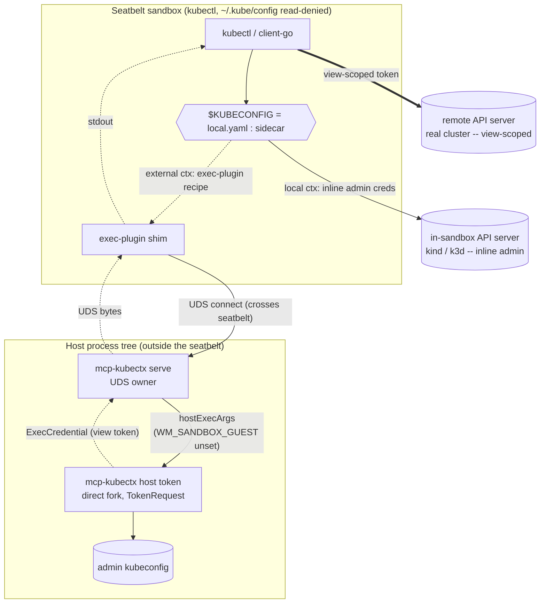

# mcp-kubectx

Cross-VM transport for Kubernetes context selection. It lets a
sandboxed Claude, such as one that runs inside a Lima guest, use
`kubectl` without the host's admin kubeconfig leaking into the guest's
filesystem. The kubeconfig the guest consumes carries no token
material. It holds only a recipe (a kubectl exec auth plugin) that
calls back to the host on demand for a short-lived ServiceAccount
token.

## Architecture

The binary has three surface areas dispatched by a single flat
switch in `cli.go`:

- **`serve`** is the long-lived MCP stdio server. It owns per-process
  state in `*handler`: the path of its scoped kubeconfig, an atomic
  `currentSA` descriptor, the per-`serve` UDS listener, and a slice of
  cleanup closures registered on each `select`. It never touches the
  cluster directly.
- **`host {list, select, token, release, sweep}`** are stateless
  one-shots. Each parses argv, talks to the cluster via client-go,
  prints JSON or text on stdout, and exits. Each takes the host
  kubeconfig, the role, and the apiserver allowlist from the host,
  never from argv, as [Host-side inputs](#host-side-inputs)
  describes. They share no state with `serve`. The only state that
  they share with each other is the
  [provision records](#provision-records) on disk. Cluster state is
  the source of truth for what exists. In-process state in `serve`
  only tracks ownership.
- **`exec-plugin`** is the kubectl exec credential shim. It
  connects to `serve`'s UDS at `--socket <path>`, copies the bytes
  the server writes to stdout, and exits. Like the `host *`
  subcommands, it never constructs a `*handler`, which is what
  keeps the structural recursion guard (see
  [Recursion guard](#recursion-guard-and-the-env-chain)) honest.

The `main` package holds only this wiring: dispatch, the `serve`
handler and MCP tools, the `host *` flag parsing, and the
wrapper-env plumbing. The domain logic lives in independent,
importable packages:

- `kubeconfig`: the minimal config model.
- `kube`: the narrow cluster-client interface and its client-go
  implementation.
- `kubetest`: a recording fake of the `kube.Client` interface.
- `serviceaccount`: provisioning, release, and the label taxonomy.
- `ledger`: the provision records on disk.
- `sweep`: orphan classification and deletion.
- `execplugin`: the kubectl exec credential protocol, both the block
  and the UDS client.
- `socket`: the slot pool, the sidecars, the accept loop, and liveness
  discovery.
- `identity`: instance and host ids.
- `statedir` and `statefile`: XDG paths and atomic state-file writes.

See the package docs in each directory for the per-package
invariants.

End-to-end credential flow:

```
kubectl exec plugin
  -> mcp-kubectx exec-plugin --socket <state>/mcp-kubectx-run/serve.<slot>.<env>.sock
     (UDS)
  -> mcp-kubectx serve  (currentSA loaded atomically)
     -> defaultRunHost("token", ...)
        -> direct fork on host
        -> workmux host-exec on guest
     -> ExecCredential JSON written back to UDS
  -> shim copies bytes to stdout
  -> kubectl reads ExecCredential, calls API server
```

The shell-out boundary is the only place where the distinction
between guest and host still matters. `*handler.hostExecArgs`
decides whether to invoke `mcp-kubectx host *` directly (when `serve`
is on the host) or wrap it with `workmux host-exec mcp-kubectx-host *`
(when `serve` is inside a Lima guest, indicated by
`WM_SANDBOX_GUEST=1`). The
distinction is invisible to kubectl: both host- and guest-side
serves write the same exec-plugin block, and routing happens
server-side.

The `host *` subcommands write their logs to stderr, one JSON record
per line. `serve` adds each record to the file of its `--log-file`
flag, whatever the exit status of the subcommand. So that log shows
each failure that `host release` or `host sweep` logs as a warning
before it exits 0, such as a failed delete.

```
mcp-kubectx serve              # MCP stdio mode, local to its Claude
mcp-kubectx host list          # one-shot: print contexts
mcp-kubectx host select <ctx>  # one-shot: create SA, print descriptor
mcp-kubectx host token         # one-shot: mint token, print ExecCredential JSON
mcp-kubectx host release       # one-shot: delete SA + binding
mcp-kubectx host sweep         # one-shot: delete orphan SAs + bindings from this host
mcp-kubectx exec-plugin        # kubectl-facing UDS shim
mcp-kubectx-host <sub>         # the host subcommands alone, for workmux host-exec
```

### Data flow

Two axes decide where bytes go:

- **Destination**: the axis splits on the cluster. kubectl reaches a
  local in-sandbox cluster directly with inline cluster-admin creds.
  It reaches a remote cluster with a `view`-scoped ServiceAccount
  token that the host mints.
- **Sandbox**: the axis splits on where `serve` runs. Under
  seatbelt-level sandboxing, `serve` sits in the host process tree and
  forks `host token` directly. Under full Lima sandboxing, `serve` sits
  inside the guest, and the mint crosses the boundary through
  `workmux host-exec`.

In both diagrams, solid edges are direct with no host round-trip,
dotted edges are the minted-credential round-trip through the UDS, and
the thick edge is the authenticated API call.

Under seatbelt-level sandboxing, `serve` runs on the host and forks
`host token` directly:



Under full Lima sandboxing, `serve` runs in the guest, and the host
mints the token through `workmux host-exec`:


Local contexts are reachable only where a cluster can physically run.
Only the Lima terrarium has a container runtime. On the Darwin host
and in the Dagger container, `local.yaml` stays an inert stub, and
every selection takes the external path. So the local edge of each
diagram carries traffic only under full Lima sandboxing.
See [Threat-model shift for local contexts](#threat-model-shift-for-local-contexts).

## Scoped kubeconfigs

`serve` writes the scoped kubeconfig of each external `select` on
its own machine, from the result of `host select`. The kubeconfig has
the same fields in a host-side and a guest-side `serve`. The cluster
section is a verbatim copy of the cluster of the selected context in
the host kubeconfig, which `host select` passes back in its result.
The `user.exec` block is the same tiny UDS shim in both host- and
guest-side kubeconfigs:

```yaml
apiVersion: v1
kind: Config
clusters:
  - name: prod-cluster
    cluster:
      server: https://prod.example.com
      certificate-authority-data: ...
contexts:
  - name: prod
    context:
      cluster: prod-cluster
      user: claude-sa-abc12345
      namespace: kube-system
users:
  - name: claude-sa-abc12345
    user:
      exec:
        apiVersion: client.authentication.k8s.io/v1
        command: mcp-kubectx
        args:
          - exec-plugin
          - --socket
          - /Users/me/.local/state/mcp-kubectx-run/serve.0.host.sock
        interactiveMode: Never
```

`command: mcp-kubectx` is a bare program name (PATH lookup) so
that nix-darwin rebuilds do not invalidate kubeconfigs; an
absolute store path would change on every rebuild and force
kubectl to start over. `mcp-kubectx` is on PATH for both the
host and the in-Lima profiles via `home.packages` in
`home/claude.nix`.

The env of `serve`, `host` or `guest`, is a _path discriminator_
only. It sets the `<env>` token in the names of the default
kubeconfig and of the socket, so a host serve and a Lima-guest serve
cannot collide on the same path.
[Concurrent-select hazard and per-`serve` paths](#concurrent-select-hazard-and-per-serve-paths)
describes the paths. Kubectl runs the same exec plugin either way.

## ExecCredential output

`host token` prints a single kubectl `ExecCredential` JSON document
on stdout:

```json
{
  "apiVersion": "client.authentication.k8s.io/v1",
  "kind": "ExecCredential",
  "status": {
    "expirationTimestamp": "2026-05-01T13:00:00Z",
    "token": "eyJhbGciOi..."
  }
}
```

kubectl caches the credential by `expirationTimestamp` and only
re-invokes the plugin when it expires. The perf cost is one fork
per token lifetime (default 1h), not per kubectl call. For a typical
Claude session that's a handful of forks total, each ~50-200 ms wall
time when round-tripping through `workmux host-exec`.

## Design rationale

The scoped kubeconfig holds the SA name, the cluster URL, and the CA.
For external contexts, no token material lives on disk inside the
VM. In-sandbox local clusters carry inline admin creds, as
[Threat-model shift for local
contexts](#threat-model-shift-for-local-contexts) describes. The token
exists in kubectl's memory for the duration of the API call and is
gone after.
Read access to the scoped kubeconfig reveals a recipe for asking
the host to mint a token, not the token itself. The host can revoke
the SA at any time.

A guest reaches the host only through `workmux host-exec
mcp-kubectx-host`, with an argv of its own choice, and that command
runs only the `host` subcommands. The host side picks the role, the
apiservers, and the kubeconfig of every SA, and the host mints a
token only for an SA that a `serve` of the caller provisioned.
[Host-side inputs](#host-side-inputs) describes the rules.

The credential path is plain kubectl exec-plugin plumbing. So every
tool that uses client-go, such as kubectl, helm, kustomize, or argocd,
works without modification. The long-lived MCP `serve` process, which
already owns the per-`serve` state, binds the Unix domain socket. So
the design does not add a daemon, and the lifetime of the UDS matches
the Claude session. The shim is the `mcp-kubectx exec-plugin`
subcommand of the same binary that kubectl already invokes, so the
deployment does not add a program.

The design rotates tokens without extra code. Each plugin invocation
asks `serve` to mint a fresh token through the TokenRequest API with
the admin kubeconfig of the host. Deleting the SA on the host
invalidates each cached token at its next API call, so the design
does not need a separate revocation channel.

The UDS lets the credential mint escape the bash sandbox. kubectl
runs under a sandbox that denies reads of `~/.kube/config`. The
credential plugin is a child of the sandboxed kubectl, so it inherits
the deny when it tries to read the admin kubeconfig itself.

Routing the mint through `serve` sidesteps the deny without
broadening any sandbox grant. On the host, `serve` runs outside the
bash sandbox. In a guest, `serve` reaches past the Lima guest through
`workmux host-exec`. The sandbox grants the connect on the single
socket path, and the token mint happens entirely outside.

## Merged kubeconfig: external + in-sandbox clusters

The launcher wrapper splits `$KUBECONFIG` into a colon-list, and each
file in the list has a single writer. So external and in-sandbox
clusters coexist behind one `kubectl` and one MCP interface. External
clusters get `view`-scoped access through mcp-kubectx, and in-sandbox
clusters get direct cluster-admin access. Off the Lima guest the list
has two entries:

```
$KUBECONFIG = $CLAUDE_KUBECTX_LOCAL : $CLAUDE_KUBECTX_SIDECAR
              ^ local.yaml            ^ kubeconfig (symlink)
              first entry             second entry
```

On the Lima guest image, the wrapper splices the guest's own
`~/.kube/config` into the middle, so the guest config becomes a
first-class local source:

```
$KUBECONFIG = $CLAUDE_KUBECTX_LOCAL : ~/.kube/config : $CLAUDE_KUBECTX_SIDECAR
              ^ local.yaml            ^ guest cluster   ^ kubeconfig (symlink)
                selection overlay       definitions       external SA creds
```

- **`$CLAUDE_KUBECTX_LOCAL`** (`$CLAUDE_KUBECTX_DIR/local.yaml`) is
  written by in-sandbox cluster tools (kind / k3d / minikube /
  k3s) and by plain `kubectl config use-context`. The wrapper
  pre-creates it as a bare stub (`apiVersion: v1` / `kind: Config`).
  mcp-kubectx writes only `current-context` here, never cluster or
  user entries.
- **Guest `~/.kube/config`** (`$CLAUDE_KUBECTX_GUEST_CONFIG`, guest
  image only) is the file a plain guest shell consults. It is
  independent of the macOS host's `~/.kube/config` and holds no host
  admin creds, and mcp-kubectx never writes it. Any guest shell
  reaches the clusters that tools such as kind, k3d, minikube, and the
  homelab Talos-in-Docker harness write there, with no env vars.
  mcp-kubectx lists the contexts of this file as `(local)` with no
  merge step for each consumer, and bare in-sandbox kubectl resolves
  their clusters, users, and creds from it.
  Only the guest image sets the `dotfiles.claude.guestKubeconfigLocal`
  build flag, which makes the wrapper export the variable and drops
  the `~/.kube/config*` Read deny.
  [Threat-model shift for local
  contexts](#threat-model-shift-for-local-contexts) covers the risk.
- **`$CLAUDE_KUBECTX_SIDECAR`** (`$CLAUDE_KUBECTX_DIR/kubeconfig`)
  is the mcp-managed symlink to the scoped kubeconfig, effectively
  read-only to kubectl. It still carries only the exec-plugin
  recipe for external contexts.

The wrapper creates `$CLAUDE_KUBECTX_DIR` for each session as the
directory `claude-kubectx.<pid>`, where `<pid>` is the process id of
Claude Code. On a Linux host, the directory lies in
`$XDG_RUNTIME_DIR`, or in `/tmp` without that variable. On a Darwin
host, it lies in `~/.local/state/claude-kubectx`, because macOS
deletes each file under `/tmp` that nothing read or changed in the
last three days. hook-router removes the directory at SessionEnd. At
each SessionStart, it also removes each directory in the same parent
whose process has exited.

Sessions that end without SessionEnd, such as after a crash, leave
their directories behind. When a later session gets the PID of such a
directory, the SessionStart sweep skips the directory while that
session runs. So the wrapper removes the directory of its own PID before it
creates the directory, and it writes the `local.yaml` stub again. Each
session starts with no `current-context` and no sidecar link.

### Collision precedence and the single-source invariant

client-go is first-file-wins for both `current-context` and context
_definitions_, so the guest config (2nd) shadows the sidecar (3rd) on
a name collision. The shadowing is safe because of one invariant that
the implementation holds: **`select` routes by union membership
first.** A name in `local.yaml` or the guest config takes the local
(no-SA) path. Only a name absent from both takes the external SA path.

With that routing, exactly one effective source defines the _selected_
context name:

- Each guest or local selection's name is in the guest config and never
  in the sidecar. Every `select` of that name routes local, so
  `host select` never mints an SA for it.
- Each external selection's name is, by the routing check, absent from
  the guest config, so the sidecar is its only definition.

kubectl resolves only `current-context`, so merge order never confuses
creds for the current context. Stale entries for other names are
inert.

The routing requires the union, and the union is more than an
optimization. The macOS host cannot reach the apiserver of a guest
context, so the SA path fails for that context, and only the local
path works.

The guest config persists, so a name collision lasts. When a guest
context and a real external context share a name, such as
`admin@main`, the guest context permanently shadows the external one,
and the SA path cannot reach it. `list` keeps the collision visible by
tagging the surviving line `(local, shadows external)` instead of
silently dropping the external context. Keep guest-cluster context
names distinct from real external ones.

**The stub must always exist.** client-go's `GetDefaultFilename`
returns the first `$KUBECONFIG` entry that _exists on disk_. When no
entry exists, it returns the first _listed_ entry.
`kubectl config use-context`, new-context writes, and tool-driven
cluster writes all target that file. Without `local.yaml`, those
writes land silently in the sidecar and corrupt mcp state.
Pre-creating the stub guarantees `local.yaml` always exists, so it
wins `GetDefaultFilename` and every local write lands there. The
sidecar stays pristine.

**`current-context` is local-authoritative.** It is the one field
that both writers want. In a merged list, client-go resolves it
first-file-wins, so `local.yaml`, the first entry, decides. `select`
writes `current-context` into `local.yaml` for _every_ kind of context:
external, guest-local, and in-sandbox-local. The creds of an external
context live in the sidecar, and the creds of a guest-local one live
in the guest config, but `select` still writes the field into
`local.yaml`. Switching is symmetric and last-writer-wins:
`kubectl config use-context <local>` and `mcp__kubectx__select
<external>` both rewrite the same field (tmp+rename atomic).

A plain guest shell's `kubectl config use-context <guest-ctx>` instead
writes `current-context` into the guest's `~/.kube/config`, not
`local.yaml`. MCP `list` reads the `(current)` marker from `local.yaml`
only, so such a selection does not show `(current)` in `list`. The
design accepts that divergence, because it keeps the marker consistent
with the bare-kubectl gate, which also keys on `local.yaml`.

### Unified `list` / `select`

Both MCP tools cover both kinds, dispatching on the context's
origin (`serve` reads `$CLAUDE_KUBECTX_LOCAL` in-process):

- **`list`** relays the external contexts from `host list`, which
  reads the admin kubeconfig. It adds the local contexts, tagged
  `(local)`. The local contexts are the union of `local.yaml` and, on
  the guest image, the guest's `~/.kube/config`, and `list` shows a
  name in both local sources once. `list` strips the ` (current)`
  suffix of `host list`, because the current-context of the admin
  kubeconfig means nothing in the merged view. Then it applies a single
  `(current)` marker from the `current-context` of `local.yaml`.
- **`select <ctx>`** branches up front by union membership. A context
  whose name is in `local.yaml` or the guest config takes the
  **local path**, which neither runs a host command nor mints an SA.
  The local path sets `current-context` in `local.yaml`, releases any
  prior external SA, and stores a nil `currentSA`, so the UDS token
  path idles. kubectl resolves the creds of the context from whichever
  local source defines it. Any other name takes the external SA-mint
  path, which mints on the host, publishes the sidecar, and writes
  `current-context` into `local.yaml`. On a name collision, **local
  wins**. To surface the shadowed external context, rename the
  colliding local one.

Plain `kubectl config use-context` keeps working for both as a
fallback, because every context lives in the one merged `$KUBECONFIG`.

### Threat-model shift for local contexts

[Design rationale](#design-rationale) says that no token material
lives on disk inside the VM. That property of the scoped kubeconfig
does **not** hold for local contexts. Local contexts carry usable
inline cluster-admin creds _inside_ the sandbox: in `local.yaml` for
an in-sandbox tool's cluster, or in the guest's `~/.kube/config` for a
guest-local one. The creds are safe there only because each such
cluster is a throwaway in-VM cluster. Nothing outside the guest can
reach it.

Nothing denies reads of these files inside the sandbox, so do not
assume that a read deny protects them. `local.yaml` is outside the
deny list. On the guest image, the
`dotfiles.claude.guestKubeconfigLocal` flag drops the `~/.kube/config*`
read deny on purpose, so the Read tool can see the definitions of
guest clusters. The dropped deny exposes no host admin
creds, because the guest `~/.kube/config` holds none. The guest file
is independent of the macOS host's `~/.kube/config`, which still never
enters the sandbox.

External access stays bound to the role that the host config grants,
`view` by default, as [Host-side inputs](#host-side-inputs)
describes.

Only the Lima terrarium VM has a container runtime, so a local
cluster can run only there. On the Darwin host and in the Dagger
container the plumbing is inert: `local.yaml` stays the bare stub and
every selection is external.

## Lifecycle and cleanup

State that matters:

1. Which SA each `serve` instance currently owns. Lives in `serve`
   process memory, in the cleanup-closure slice.
2. Which SAs exist on the cluster. Authoritative: the cluster.
   Tagged with `app.kubernetes.io/managed-by=mcp-kubectx`.
3. Which SAs a `serve` instance provisioned and nobody released.
   Lives on the host disk, in the
   [provision records](#provision-records). This state outlives
   the `serve`, so a later `serve` can delete what a dead one left
   behind.

On a new MCP `select` call, `*handler.selectCtx` snapshots the
previous cleanup list, clears the live one, and shells out to `host
select`. On success it registers a fresh release closure for the new
SA and drains the prior closures **inline** with a 30-second
`context.Background` timeout before returning the MCP response. The
drain has to be synchronous, because deriving from the request
context would let the MCP SDK cancel the in-flight
DeleteServiceAccount calls as soon as `selectCtx` returned, re-leaking
the prior SA. On failure, or when `serve` cannot parse the JSON of
`host select`, `restoreCleanups` swaps the previous list back, so
`serve` still releases the prior SA at shutdown.

The cleanup closure that `sessionDir` returns runs at each return of
`runServe` after the socket bind, because `runServe` defers the
closure right after the bind. `runServe` returns when the MCP client
closes the stdin of `serve`, when SIGINT or SIGTERM arrives, or when
the connection to the client fails.

To stop a stdio server, the MCP specification asks the client to
close the stdin of the server first. It asks for SIGTERM only when
the server does not exit after that. Claude Code 2.1.319 does not
follow that order on Linux or macOS. It sends SIGINT to `serve`
first. When `serve` still runs 100 ms later, Claude Code sends
SIGTERM, and when `serve` still runs 400 ms after that, it sends
SIGKILL. So with Claude Code as the client, the closure usually
starts on SIGINT.

The stdin of `serve` closes with no signal when a client follows the
order of the specification, or when Claude Code ends without its
signal sequence, such as when it crashes. Only a crash of `serve` or
a signal that `serve` does not catch, such as SIGKILL or SIGHUP,
ends `serve` before the closure runs or while it runs.

The closure runs in this order:

1. `socketShutdown` closes the UDS listener and waits on a
   `sync.WaitGroup` for in-flight per-connection handlers to
   return. This is required so no handler is mid-token-mint when
   the next steps unlink files. The listener close unlinks the
   per-slot sidecar file at `<socket-path>.id`, which holds the
   `instance-id` of this `serve`, and then the socket file at
   `h.socketPath`.
2. Unlink the scoped kubeconfig at `h.lastOutputPath`.
3. Unlink the hook-router sidecar symlink. The link lies in a
   directory of the machine that runs `serve`, so it never crosses
   the Lima boundary.
4. `drainSweep` waits for the background `host sweep` goroutine to
   return, for at most 30 seconds. The timeout keeps a hung
   `host sweep` subprocess from blocking shutdown. When the wait
   times out, `serve` logs a warning and runs the next step. A
   SIGINT or a SIGTERM, before the closure or during it, cancels the
   sweep. When neither signal arrives, the wait lasts until the
   sweep ends or until the timeout passes.
5. Drain registered SA release closures with a 30-second
   `context.Background` timeout.

The listener close unlinks the sidecar file while the listener
still holds the slot. The unlink of the socket file then frees the
slot. A new `serve` might bind the slot and write its own sidecar
file while step 1 waits for a token mint. The closure never unlinks
either file after the listener close, so it leaves the files of
that new `serve` in place.

The unlinks are local and take microseconds. Step 4 and step 5 can
take seconds, and neither reads the files that the unlinks remove.
So the unlinks run first.

Claude Code sends its SIGKILL about 500 ms after the SIGINT that
starts the closure. A closure that runs longer, for example while a
`host release` of step 5 runs, then ends partway, and its later
steps never run. So under the signal sequence of Claude Code, the
closure never reaches the 30-second limit of step 4 or step 5. A
SIGKILL during step 4 or step 5 leaves behind only the SAs that
`serve` had not released, with their bindings and provision records.
The SIGKILL reaches only `serve`, so a `host release` subprocess
that has started keeps running after `serve` ends.

When `serve` ends before the closure starts, it leaves the items in
this list behind. When `serve` ends while the closure runs, it leaves
only the items of the steps that have not run. The socket inode and
the per-slot sidecar file are the exception, because closing the
listener unlinks both. A SIGINT or a SIGTERM closes the listener at
once, and step 1 closes it when it is still open. So a `serve` that
ends during the closure leaves neither file.

- **SAs and bindings.** Each SA that the `serve` had not released
  stays on its cluster with its binding. The orphan sweep at the
  startup of a later `serve` with the same host kubeconfig deletes
  them on whichever cluster they lie, because each SA has a
  provision record on the host. That
  sweep deletes only the resources of its own `host-id`. The
  host-side serves of one host share a `host-id`, and so do the
  guest-side serves of one Lima guest VM.
  [Manual sweep invocation](#manual-sweep-invocation) describes the
  sweep of another `host-id` and the cleanup after a deleted guest
  VM.
- **Provision records.** The record of each such SA stays in the
  ledger directory on the host. The same sweep removes each record
  after it has deleted the SA and the binding.
- **Socket inode.** The inode stays at the slot of the killed
  `serve`. The stale-clearance step of `socket.Listen` unlinks it
  when a later `serve` takes the slot.
- **Per-slot sidecar file.** The file stays at `<socket-path>.id`.
  The same stale-clearance step unlinks it when a later `serve` takes
  the slot, whether or not the socket inode remains.
- **Scoped kubeconfig.** The file exists after the first successful
  `select` of an external context. No step removes it, and
  [Out of scope](#out-of-scope) describes the manual cleanup.
- **hook-router sidecar symlink.** The link exists after the first
  successful `select` of an external context. hook-router removes it
  at SessionEnd, together with the rest of `$CLAUDE_KUBECTX_DIR`.

Each `serve` takes its slot during the walk of `socket.Acquire`. At
each slot of the walk that holds a socket inode, the stale-clearance
step dial-tests the socket path. When the dial fails, for example
with ECONNREFUSED, the socket inode is leftover state. The step then unlinks the inode and the
sidecar file before the bind. When the dial succeeds, a live peer
holds the slot, so the walk advances to the next slot.

`$CLAUDE_KUBECTX_DIR` holds the sidecar symlink only in a session
that the launcher wrapper started.
[Merged kubeconfig](#merged-kubeconfig-external--in-sandbox-clusters)
describes what removes the directory after a session that ended
without SessionEnd. While the session still runs, another `serve` in
the session replaces the link at its next successful `select` of an
external context. That `serve` also removes the link when its
cleanup closure runs, even when it never ran a `select`.

Outside a session of the launcher wrapper, `serve` writes the link to
`<TMPDIR>/claude-kubectx/<PPID>/kubeconfig` on the machine that runs
it. No hook removes that link. So it stays until that machine cleans
its temporary directory, or until a later `serve` with the same
parent process replaces or removes it.

The `TestSelect*`, `TestSessionDir*`, `TestDrainSweep*`, and
`TestServeSocket*` test families pin the behaviors that this section
describes. The `TestClearStale*` tests of the `socket` package pin
the removal of a leftover sidecar file. The `TestListenClose*` tests
of that package pin the unlinks of a listener close and their order.

## Orphan sweep

The orphan sweep deletes the SAs and bindings that a dead `serve`
left behind. It finds them by the labels on the resources and by the
provision records that `host select` writes on the host.

Every provisioned SA and binding carries three labels:

- `app.kubernetes.io/managed-by=mcp-kubectx`
- `mcp-kubectx/host-id=<digest>`: the 16-hex digest of the host id.
  The host id is a 16-hex id persisted at
  `<XDG_STATE_HOME>/mcp-kubectx-run/<env>.key` (`host.key` or
  `guest.key`), mode `0600`, on the machine that runs the `serve`.
  `serve` creates it on its first startup. The label bounds the sweep
  to resources this host+env owns, so two operators against a shared
  cluster never delete each other's resources.

  The `host` subcommands take the host id and derive the digest, and
  no one can find a host id from its digest. So a Lima guest, which
  can read the labels with its token, sweeps only the resources of
  the `guest.key` of its own VM.

  Builds of mcp-kubectx before the digest kept the host id in
  `host.id` or `guest.id` and put the plain id on each label, where
  every guest can read it. `serve` does not read those files. So each
  env mints a fresh id in its `.key` file, and a guest that read an
  old id from a label cannot act on the resources of the fresh id.
  [Manual sweep invocation](#manual-sweep-invocation) describes how
  to delete the resources of those builds.

  The id is per-env because the liveness discovery of each env
  vouches only for the serves of that env. One id for both envs lets
  a host-side sweep delete the live SA of a concurrent guest serve,
  and the other way around.

- `mcp-kubectx/instance-id=<per-serve random>`: 16-hex id
  generated fresh for each `serve` process. Persisted into a
  per-slot sidecar file at `<socket-path>.id` so a future
  `serve` can attribute a live UDS slot back to its bound
  `instance-id`.

Each `serve` resolves `<XDG_STATE_HOME>` in its own environment. So
`host.key` lies on the host, and each Lima guest VM keeps the
`guest.key` of its guest-side serves on its own disk. workmux mounts
neither file into a guest. When you delete a guest VM, its
`guest.key` goes with it, and no later `serve` sweeps the resources
that the serves of that VM left behind.
[Manual sweep invocation](#manual-sweep-invocation) describes how to
delete them.

Each `serve` launches a background `host sweep` at startup. It
passes the sweep its own `host-id`, the live set, and the time at
which it took the live set. The live set holds the `instance-id` of
each live `serve` of its env. The `serve` collects the live set from
the live UDS sidecars across the slot pool. The sweep runs two passes
at the same time, and both delete only resources of that `host-id`.

| Pass   | Clusters                                                    | Deletes                                                                                                                                   |
| ------ | ----------------------------------------------------------- | ----------------------------------------------------------------------------------------------------------------------------------------- |
| Label  | The cluster of the `current-context` in the host kubeconfig | Each labeled SA and binding whose `instance-id` is not live and that the apiserver created more than a minute before the live set         |
| Record | Each cluster of the host kubeconfig that a record names     | The SA and the binding of each record whose `instance-id` is not live and that `host select` wrote more than a minute before the live set |

The label pass covers one cluster, because the labels do not say
which other clusters hold resources of this host. A `serve`
provisions on the cluster of the context that the MCP `select` call
names, and that context is often not the `current-context` of the
host kubeconfig. The record pass reaches those clusters.

The label pass runs these steps:

1. It lists SAs, RoleBindings, and ClusterRoleBindings filtered by
   the selector `managed-by=mcp-kubectx,host-id=<digest>` on the
   apiserver. Cross-host resources never reach the classifier.
2. For each result, it reads `mcp-kubectx/instance-id`. It keeps a
   resource without that label, because the label pass cannot tell
   which `serve` owns the resource. It keeps a resource whose value
   is in the live set.
3. It keeps each resource that the apiserver created a minute or
   less before the `serve` took the live set, or later. It deletes
   every other resource, best-effort.

The live set misses each `serve` that starts after the sweeping
`serve` takes it. Such a `serve` can provision on the cluster before
the list calls of the label pass answer, such as while a credential
plugin or a slow apiserver holds the list calls. So the label pass
compares the `creationTimestamp` of each resource with the time of
the live set, less one minute. The minute covers the whole seconds of
`creationTimestamp` and a clock of the apiserver that runs behind the
clock of the `serve`. A resource of a dead `serve` that the apiserver
created in that minute stays until the sweep of a later `serve`.

The record pass runs these steps:

1. It reads the provision records of its `host-id` before the first
   cluster call. It takes each record whose `instance-id` is not in
   the live set and that names the host kubeconfig of the sweep.
2. It keeps each record that `host select` wrote a minute or less
   before the `serve` took the live set, or later.
3. For each other record, it deletes the SA and the binding by name,
   through the context of the record in the host kubeconfig. A
   resource that the cluster does not hold counts as deleted.
4. It removes the record after the cluster holds neither resource.
   When a delete fails, it keeps the record, so the sweep of the
   next `serve` tries again.

Each `serve` that starts after the live set can also run
`host select` before the record pass reads the ledger. So the record
pass compares the time of each record with the time of the live set,
less one minute. `host select` takes the time of a record from the
clock of the host. The minute covers a clock of the `serve`, such as
the clock of a Lima guest, that runs ahead of the clock of the host.
A record of a dead `serve` that `host select` wrote in that minute
stays until the sweep of a later `serve`.

`host sweep` takes the time of the live set from `--live-as-of`.
When that time lies after the start of `host sweep`, the clock of
the `serve`, such as the clock of a Lima guest, runs ahead of the
clock of the host. Both passes then use the start of `host sweep`
instead.

The record pass keeps each record that names another kubeconfig
file, and it never loads that file. The environment of each caller
picks its host kubeconfig, as [Host-side inputs](#host-side-inputs)
describes. So a host-side `serve` and a Lima guest can write records
of different files.

The record pass gives the API calls of one cluster at most 30
seconds, and it works on the clusters in parallel. So a cluster that
does not answer delays no other cluster. A credential plugin of a
context runs outside that limit, because client-go starts the plugin
without the context of the call.

Both passes log each failure, such as a Forbidden list or a failed
delete, at warn level, and no failure blocks `serve` startup. `host
sweep` writes these warnings to its stderr, and `serve` adds each
one to its log, whatever the exit status of `host sweep`.

### Provision records

A provision record says that one `serve` owns one SA. The record
holds the path of the host kubeconfig, the context, the namespace,
the SA name, and whether the binding is a ClusterRoleBinding. With
these fields the record pass deletes the SA and the binding by name,
without a `list` call. The record also holds the time of its write,
so that the record pass keeps the record of a `serve` that started
after the live set.

Each record is one JSON file on the host, mode `0600`, at this path:

```
<XDG_STATE_HOME>/mcp-kubectx-run/ledger/<digest>.<instance-id>.<key>.json
```

`<digest>` is the digest of the host id, as in the `host-id` label.
`<key>` is a hash of the kubeconfig path, the context, the
namespace, and the SA name. The ledger directory lies beside the
sockets, which workmux does not mount into a Lima guest. `host
select`, `host release`, and `host sweep` always run on the host, so
the records of a guest-side `serve` lie on the host too.

A record is also the proof that a `serve` owns its SA. The host
kubeconfig can mint a token for, and delete, any SA of a cluster.
So `host token` and `host release` act only on an SA whose record
names the `--host-id` and `--instance-id` that the caller passes.
A guest cannot mint a token for an SA of the cluster that no
`serve` of its own provisioned.

These events write and remove a record:

| Event                                                                                   | Record                                          |
| --------------------------------------------------------------------------------------- | ----------------------------------------------- |
| `host select` is about to create the SA for a `serve`                                   | Written before the create call                  |
| The apiserver refuses a create call of `host select`, such as with Forbidden            | Removed                                         |
| A create call of `host select` fails without a refusal, such as after a lost connection | Kept until a record pass after the `serve` ends |
| A create call of `host select` gets AlreadyExists                                       | Kept until a record pass after the `serve` ends |
| `host select` cannot roll back the SA after a failed binding                            | Kept until a record pass after the `serve` ends |
| `host release` deletes the SA and the binding                                           | Removed                                         |
| `host release` cannot delete the SA or the binding                                      | Kept until a record pass after the `serve` ends |
| The record pass deletes the SA and the binding                                          | Removed                                         |
| The record pass cannot delete the SA or the binding                                     | Kept for the record pass of the next `serve`    |
| The record pass finds a record of another kubeconfig                                    | Kept for a record pass of that kubeconfig       |
| The record pass finds a record that `host select` wrote after the live set              | Kept for the record pass of a later `serve`     |

`host select` writes the record first. A `host select` that dies
before the create call then leaves a record of an SA that does not
exist. The record pass removes such a record, because a resource
that the cluster does not hold counts as deleted.

After a create call that fails without a refusal from the apiserver,
`host select` keeps the record. The apiserver might have stored the
SA or the binding before the call failed, for example from a lost
connection or a timeout. The record pass then deletes each of them
that the cluster holds. When the cluster holds neither, the deletes
find nothing, and the record pass removes the record.

`host select` also keeps the record after an AlreadyExists answer.
When the apiserver times out on a write to its storage, it asks the
client to try again. Then client-go sends the create a second time.
The second attempt gets AlreadyExists when the first one stored the
SA or the binding. An object of another owner with the same name is
far less likely, because each SA name holds 8 random hex characters.
The binding takes its name from the SA.

`host select` requires both `--sa-host-id` and `--sa-instance-id`,
which `serve` always passes.

The sweep does not cover these cases:

- **An SA without a record on a cluster other than the
  `current-context`.** An SA has no record when a build of
  mcp-kubectx without provision records created it, or when someone
  removed the record file.
  [Manual sweep invocation](#manual-sweep-invocation) describes the
  recovery.
- **A record of another kubeconfig.** Such records come from a
  caller whose environment resolves another host kubeconfig, such as
  a host-side `serve` with `$KUBECONFIG_HOST` set, or a Lima guest.
  Each one waits for the startup sweep of a `serve` that uses its
  kubeconfig.
  [Manual sweep invocation](#manual-sweep-invocation) describes how
  to release it by hand.
- **A record whose cluster never answers again.** The record pass
  tries such a record at the startup of every `serve`, and the log
  of that `serve` holds a warning for each failed attempt. To find
  such a record, list
  `<XDG_STATE_HOME>/mcp-kubectx-run/ledger` on the host. After its
  `serve` has ended, a record stays past the startup of the next
  `serve` only when the sweep cannot release it. The JSON of the
  record names the kubeconfig, the context, the namespace, and the
  SA. To stop the attempts, delete the file.

### Permission requirement

The label pass requires cluster-wide `list` verb on three resource
kinds in the host kubeconfig:

- `serviceaccounts.v1`
- `rolebindings.rbac.authorization.k8s.io`
- `clusterrolebindings.rbac.authorization.k8s.io`

`host release` and the record pass delete each resource by name, so
they need `delete` and no `list`. If `list` is forbidden on all
three kinds, the label pass logs a warning and `serve` startup
continues (the goroutine swallows the resulting `sweep.ErrList`).
When `list` works on some kinds but not on others, the label pass
processes the kinds that it can list. The record pass does not wait
for the label pass, and it runs whatever the label pass returns.

### Orphans without `host-id`

The sweep cannot tie a resource that carries
`managed-by=mcp-kubectx` but no `mcp-kubectx/host-id` label to a
specific host, so it leaves that resource alone. To recover, run
manually after stopping any live serves:

```
kubectl delete sa,rolebinding -A \
  -l 'app.kubernetes.io/managed-by=mcp-kubectx,!mcp-kubectx/host-id'

kubectl delete clusterrolebinding \
  -l 'app.kubernetes.io/managed-by=mcp-kubectx,!mcp-kubectx/host-id'
```

The `!host-id` LabelSelector clause matches resources where the
label is absent. There is no `--sweep-unlabeled` flag on the
binary: the per-startup sweep cannot tell whose orphan it would
be deleting, so recovery stays a separate manual command the
operator runs once.

### Manual sweep invocation

Run `host sweep` by hand to delete the orphans that the startup sweep
does not cover.

Before you sweep a `host-id`, stop every running `serve` that holds
that id. Without `--live-instance-id` flags the sweep treats every
`serve` as dead.
The label pass then deletes every resource with the matching
`host-id` and a non-empty `instance-id` label, and the record pass
deletes the SA of every record of that `host-id`. Without
`--live-as-of`, the label pass still keeps each resource that the
apiserver created a minute or less before `host sweep` started, or
later. The record pass keeps each record that `host select` wrote in
that time.

To sweep one cluster by label, name its context:

```
mcp-kubectx host sweep \
  --context my-ctx \
  --host-id $(cat ~/.local/state/mcp-kubectx-run/host.key)
```

With `--context`, the sweep runs only the label pass, on the cluster
of that context, and it leaves the provision records alone. This
form deletes an orphan that has no record on a cluster other than
the `current-context`.

To run both passes, as `serve` does at startup, omit `--context`:

```
mcp-kubectx host sweep \
  --host-id $(cat ~/.local/state/mcp-kubectx-run/host.key)
```

`host sweep` takes no flag for the host kubeconfig. It reads
`$KUBECONFIG_HOST`, then `$KUBECONFIG`, then `~/.kube/config`, as
[Host-side inputs](#host-side-inputs) describes. The record pass
releases only the records of that kubeconfig. To release the records
of another kubeconfig, set `$KUBECONFIG_HOST` to the path that the
records name. The sweep runs the exec credential plugin of that file,
so read the file before you sweep with it:

```
KUBECONFIG_HOST=/path/from/the/records mcp-kubectx host sweep \
  --host-id $(cat ~/.local/state/mcp-kubectx-run/host.key)
```

The `host sweep` commands of this section read `host.key` on the
host, so they sweep the resources of host-side serves. Each Lima
guest VM keeps the `guest.key` of its guest-side serves on its own
disk, and the host does not hold a copy. To sweep the resources of
one guest VM, print its id inside the guest:

```
cat ~/.local/state/mcp-kubectx-run/guest.key
```

Then run the `host sweep` commands of this section on the host, with
`--host-id` set to that id. `workmux host-exec` passes no kubeconfig
variable, so the records of guest-side serves name `~/.kube/config`
of the host. Set `$KUBECONFIG_HOST` to that path when your shell
sets `$KUBECONFIG` to another file.

When you delete a guest VM, its `guest.key` goes with it. The labels
and the ledger hold only the digest of each host id, and `host
sweep` needs the host id itself. So no `host sweep` reaches the
resources of a deleted VM, and you delete them with kubectl. To find
the digest of a deleted VM, list the ledger directory on the host:

```
ls ~/.local/state/mcp-kubectx-run/ledger
```

The name of each record file starts with the digest in the
`host-id` label of its SA. `host select` writes every record of this
directory on the host, for the serves of the host and of its guest
VMs. To print the digest of an id file, such as `host.key` or the
`guest.key` of an existing VM, run this command where the file lies:

```
printf 'mcp-kubectx/host-id\0%s' "$(cat ~/.local/state/mcp-kubectx-run/host.key)" \
  | shasum -a 256 | cut -c1-16
```

A ledger digest that matches neither the digest of `host.key` nor the
digest of the `guest.key` of an existing VM comes from one of these
sources:

- **A deleted guest VM.** The `guest.key` of the VM went with it.
- **A former `host.key` of this host or `guest.key` of an existing
  VM.** `serve` writes a new id file when the file is missing or does
  not hold a valid id. Every guest can delete or rewrite its own
  `guest.key` on its own disk. You can delete either file too.
- **The choice of a guest.** Every guest can run `host select` with
  any id as `--sa-host-id`.
- **A build of mcp-kubectx before the digest.** Such a build kept
  the host id in `host.id` or `guest.id`. It wrote the plain id into
  each label and each record name, so the name starts with the
  content of that file. No `host sweep` reaches these resources,
  because the sweep selects the digest of the id that you pass.
  `serve` does not read or remove the old file. It lies in
  `~/.local/state/mcp-kubectx-run`, or in `~/.local/state/mcp-kubectx`
  for a build that kept it in the mounted state dir.

The JSON of each record names the context, the namespace, and the
SA. Before you delete the resources of such a digest, list them on
each cluster that its records name:

```
kubectl get sa,rolebinding -A -l mcp-kubectx/host-id=<digest>
kubectl get clusterrolebinding -l mcp-kubectx/host-id=<digest>
```

Delete them only when they belong to a VM that you deleted, to a
former `host.key` of this host or `guest.key` of an existing VM, or to
a build before the digest. For a build before the digest, put the
plain id where the commands name `<digest>`. Then delete the record
files of the digest:

```
kubectl delete sa,rolebinding -A -l mcp-kubectx/host-id=<digest>
kubectl delete clusterrolebinding -l mcp-kubectx/host-id=<digest>
rm ~/.local/state/mcp-kubectx-run/ledger/<digest>.*.json
```

## Recursion guard and the env chain

The risk is that a host-side `mcp-kubectx-host token`, which a
guest-side `serve` starts, could observe `WM_SANDBOX_GUEST=1` in its
environment and try to wrap itself with `workmux host-exec`,
recursing back across the boundary. Two independent defenses prevent
this.

**Design rule (structural).** Only `*handler` decides whether to
wrap with `workmux host-exec`. `hostExecArgs` is a method on
`*handler` (`shellout.go`), and neither the `host *` subcommand
entry points nor `exec-plugin` construct a `*handler`, so they
have no path to `runHost` and no way to invoke the wrapper.
`host token` reads the cluster directly via
`kube.Client.CreateTokenRequest`; `exec-plugin` is a pure UDS
client and does not even import the K8s client. The mechanism is
syntactic. There is no path through the call graph; it is not a
runtime env-var check.

**workmux env sanitization.** `workmux host-exec` strips every env
var not in its allowlist (`PATH`, `HOME`, `USER`, `LOGNAME`,
`TMPDIR`, `TERM`, `COLORTERM`, `LANG`, `LC_ALL`, `XDG_*`; see
`sandbox/rpc.rs` in workmux). Neither `WM_SANDBOX_GUEST` nor
`WM_RPC_TOKEN` is on that list, so the host-side `mcp-kubectx-host
token` literally cannot observe itself as guest, and could not
authenticate back to the RPC server even if it tried.

**End-to-end env chain (guest variant).** workmux starts the in-VM
Claude with `WM_RPC_HOST`, `WM_RPC_PORT`, and `WM_RPC_TOKEN` in its
environment, and the guest-side `serve` inherits them. kubectl runs
the exec plugin `mcp-kubectx exec-plugin`, which asks that `serve`
for a token over its guest-local socket. `serve` then runs `workmux
host-exec mcp-kubectx-host token ...`, which reaches the RPC server
of the host with the inherited variables. The RPC server forks
`mcp-kubectx-host token` on the host with a sanitized env that holds
no `WM_*` variable. The token subcommand needs nothing from the
workmux env, and it talks only to Kubernetes.

**PATH chain.** `home.packages` in `home/claude.nix` holds the
wrapped `workmux` binary and `mcp-kubectx`, so the home-manager
profile puts both on the in-guest PATH. The guest-side `serve`
resolves `workmux` there, and kubectl resolves the `command:
mcp-kubectx` of the exec plugin there. workmux also puts a shim
directory first on the PATH of the guest agent, with a shim that
runs `workmux host-exec <name>` for each name in `host_commands`.
That list names `mcp-kubectx-host`, so workmux creates no shim named
`mcp-kubectx`. Each VM that ran with `mcp-kubectx` in that list
keeps a stale shim of that name until you delete it, as
[Existing VMs](#existing-vms) describes.

The structural defense is pinned by
`TestHostTokenSkipsWorkmuxWhenEnvSetToGuest`, which sets
`WM_SANDBOX_GUEST=1` and confirms `runHostToken` calls
`CreateTokenRequest` directly with no intermediate fork. The entry
point of the `exec-plugin` shim does not link the Kubernetes client.
So the structural property is visible at compile time, and the shim
does not need an analogous test.

## Deployment requirement: workmux host_commands allowlist

A guest-side `serve` reaches the host only when the workmux config of
the host allows the command `mcp-kubectx-host`. `package.nix`
installs `mcp-kubectx-host` as a link to `mcp-kubectx`, and
`home/claude.nix` adds the name to the `sandbox` attrset:

```nix
sandbox = lib.optionalAttrs cfg.lima.enable {
  # ...existing keys (enabled, backend, image, ...)...
  host_commands = [ "mcp-kubectx-host" ];
  # ...
};
```

workmux merges the user list with its builtins via
`effective_host_commands` and gates `Exec` RPCs against the result.
The RPC server of a host without this entry refuses each
`workmux host-exec mcp-kubectx-host ...` call of a guest.

workmux checks only the command name, so each guest can run
`mcp-kubectx-host` on the host with any argv.
[Host-side inputs](#host-side-inputs) describes what such an argv
can reach.

### Existing VMs

After the host switches, you must update each workmux VM that ran
with `mcp-kubectx` in `host_commands`. Until then, mcp-kubectx fails
in the guest. The VM keeps these parts from the time that workmux
created it:

- **Guest binary:** the guest runs the `mcp-kubectx` of the golden
  image that created the VM, until you switch the VM. That `serve`
  runs `workmux host-exec mcp-kubectx host ...`, and the RPC server
  of the host refuses the call with exit status 127. So `list` and
  `select` fail in the guest.
- **Shims:** workmux keeps each shim after its name leaves
  `host_commands`, so the VM keeps a shim named `mcp-kubectx`.
  kubectl in the guest runs that shim, and the host refuses the call
  too.
- **Mounts:** workmux reads `extra_mounts` only when it creates a VM,
  so the VM keeps its writable mount of `~/.local/state/mcp-kubectx`
  of the host. mcp-kubectx keeps none of its files in that directory.

The shim directory of each VM lies on the host at
`~/.local/state/workmux/lima/<vm>/shims/bin`. workmux mounts it into
the guest and puts it first on the PATH of the guest agent. So the
stale shim comes before the `mcp-kubectx` of the home-manager
profile, and kubectl runs `workmux host-exec mcp-kubectx exec-plugin
...` for each credential.

You can recreate each VM or switch it. A recreated VM gets the
current binary, mounts, and shims. But the recreation deletes the
disk of each VM, which holds every file that the VM keeps outside its
mounts.

To recreate the VMs, wait until no session in a workmux VM has work
in progress, and run these commands on the host:

```sh
task lima:image
workmux sandbox prune
```

`task lima:image` builds the golden image from the current config.
`workmux sandbox prune` deletes each workmux VM together with its
state directory, which holds the stale shim. Then restart each
workmux sandbox, and workmux creates its VM from the new image.

To keep a VM, take these steps:

1. In the VM, run `task switch`, so that the guest runs the current
   `mcp-kubectx`.
2. On the host, delete the stale shim of each VM:

   ```sh
   rm -f ~/.local/state/workmux/lima/*/shims/bin/mcp-kubectx
   ```

3. Restart each workmux sandbox. workmux reads `host_commands` when a
   sandbox starts, so the RPC server of a running sandbox refuses
   `mcp-kubectx-host` until the sandbox restarts. The restart also
   starts the guest `serve` again, from the binary that the switch
   installed.

Each VM that you keep has its mount of `~/.local/state/mcp-kubectx`
until workmux creates the VM again.

## Host-side inputs

The `host` subcommands take every limit and every path from the
host, never from their argv. So a Lima guest that runs them through
`workmux host-exec` gets only what the host config grants: the
configured role, on an allowlisted apiserver, through the host
kubeconfig.

| Input                        | Source on the host                                                                          |
| ---------------------------- | ------------------------------------------------------------------------------------------- |
| Role, binding, and namespace | The host config                                                                             |
| Apiserver allowlist          | The host config                                                                             |
| Token lifetime               | The host config                                                                             |
| Host kubeconfig              | `$KUBECONFIG_HOST`, then `$KUBECONFIG` outside `$CLAUDE_KUBECTX_DIR`, then `~/.kube/config` |
| Provision records            | `<XDG_STATE_HOME>/mcp-kubectx-run/ledger`                                                   |
| Scoped kubeconfig            | No `host` subcommand writes one. `serve` writes its own on its own machine                  |

The host config is the JSON file `mcp-kubectx/config.json` in
`$XDG_CONFIG_HOME`, or in `~/.config` when `$XDG_CONFIG_HOME` does
not hold an absolute path. `home/claude.nix` writes it from the
`dotfiles.claude.kubeClusterRole` and `dotfiles.claude.kubeApiDomains`
options:

```json
{
  "role": "view",
  "clusterScoped": true,
  "allowedAPIServerHosts": ["k8s.example.com"]
}
```

| Key                     | Meaning                                                                        | Default                                    |
| ----------------------- | ------------------------------------------------------------------------------ | ------------------------------------------ |
| `role`                  | Name of the Role or ClusterRole to bind                                        | Required                                   |
| `roleKind`              | `Role` or `ClusterRole`                                                        | `ClusterRole`                              |
| `clusterScoped`         | Bind with a ClusterRoleBinding, which needs a ClusterRole                      | `false`                                    |
| `namespace`             | Namespace of each ServiceAccount                                               | The namespace of the context, or `default` |
| `expiration`            | Token lifetime in seconds, at most 86400                                       | 3600                                       |
| `allowedAPIServerHosts` | Hostnames that `host select` accepts as the `server` of a cluster, in any case | Empty, which accepts every apiserver       |

`host select` and `host token` fail when the file is missing, when it
does not parse, and when it holds a key outside this table. So a
misspelled key never leaves the allowlist empty.

`workmux host-exec` passes neither `$KUBECONFIG_HOST` nor
`$KUBECONFIG`, so a `host` subcommand that a guest starts reads
`~/.kube/config` of the host. The `host` subcommands refuse to run
when they cannot resolve an absolute home directory, because
`workmux host-exec` runs them in a worktree that the guest can
write.

The argv names only the context, the ServiceAccount, and its owner,
which is the host id and the instance id of a `serve`. The
`host-id` label and the provision records carry the digest of the
host id, as [Orphan sweep](#orphan-sweep) describes. `host token`,
`host release`, and `host sweep` act only on the resources of the
host id that their caller passes. A guest can read each digest from
the labels with its token, but it cannot find a host id from its
digest. So a guest acts only on the resources of the `guest.key` of
its own VM, and of each other id that it holds.

A guest reaches the host only as `mcp-kubectx-host`, the name that
the workmux `host_commands` of `home/claude.nix` allows. Under that
name, the binary runs only the `host` subcommands, with no `host`
word in front, and it refuses every other argv. So a guest cannot
start these subcommands on the host:

- **`serve`:** its `--output` and `--log-file` flags name a file of
  the host that `serve` removes or appends to, such as `host.key` or
  a provision record.
- **`exec-plugin`:** it reads a token from the socket of a host-side
  `serve`.

workmux runs `mcp-kubectx-host` without the toolchain of the
worktree. Upstream workmux wraps each host command in `nix develop`
when the worktree holds a `flake.nix`, or in `devbox run` when it
holds a `devbox.json`. The guest writes the worktree, so the wrapper
runs code of the guest on the host, and that code can set
`$KUBECONFIG_HOST` and `$XDG_CONFIG_HOME` for the `host`
subcommands. The workmux overlay in `lib/default.nix` patches the
wrapper out of every host command. `mcp-kubectx-host` lives in the
Nix store, so it does not need the toolchain.

## Concurrent-select hazard and per-`serve` paths

Each `serve` writes its scoped kubeconfig on its own machine. One
machine can run several serves, one for each Claude Code session,
and each of them writes a kubeconfig of its own. So the default path
holds the pid of `serve`, and two serves that run at the same time
on one machine get different default paths. The path also holds the
env of `serve`, `host` or `guest`:

```
<XDG_STATE_HOME>/mcp-kubectx-run/kubeconfig.<pid>.<env>.yaml
```

`serve` resolves `<XDG_STATE_HOME>` in its own environment, with a
fallback to `~/.local/state`. So the kubeconfig of a host-side
`serve` lies on the host, and the kubeconfig of a guest-side `serve`
lies on the disk of its guest VM. workmux mounts no part of
`mcp-kubectx-run` into a guest. `--output PATH` replaces the default
path, and `serve` resolves that path on its own machine too.

`serve` writes each kubeconfig to a new file under a random name in
the directory of the path, and then it renames that file to the
path. So a symlink at the path does not receive the kubeconfig.
`serve` opens its `--log-file` with `O_NOFOLLOW`. When the last
element of that path is a symlink, `serve` fails to start.

The files that host-side serves write or trust lie in
`<host's $XDG_STATE_HOME>/mcp-kubectx-run`, beside the sockets and
the [provision records](#provision-records):

- `kubeconfig.<pid>.host.yaml`: the scoped kubeconfig of each
  host-side `serve`. Host-side kubectl reads it through the
  hook-router sidecar symlink and runs the exec plugin that the file
  names. The file also names the apiserver that receives each token
  that the `serve` mints.
- `host.key`: the host id of host-side serves. Every host-side
  `serve` reads it at startup for the owner of its resources and for
  the selector of its orphan sweep. The startup sweep deletes each
  resource of that host id whose `serve` is missing from its live
  set.
- `kubectx.log`: the log of host-side serves, at the path that
  `home/claude.nix` passes as `--log-file`.

Every guest-side `serve` resolves its state dirs in the guest, under
the home directory of the guest. So the `guest.key` and the scoped
kubeconfig of guest-side serves stay in `mcp-kubectx-run` on the disk
of the guest VM. `serve` writes its log to the `--log-file` path as
given, and `home/claude.nix` renders that path from the
`xdg.stateHome` of the machine that it configures. So on a guest VM
that `home/claude.nix` configures, the log of guest-side serves lies
in `mcp-kubectx-run` on the disk of the guest VM too.

The hook-router sidecar symlink published by [*handler.publishSidecar]
points at the scoped kubeconfig. The MCP `select` response carries
the path back to the caller so an interactive shell can
`export KUBECONFIG=...` to it. Each `serve` removes its own
kubeconfig file on shutdown alongside the `host release` of its
current SA.

### Sockets on the local filesystem

The per-`serve` UDS lives at
`<state>/mcp-kubectx-run/serve.<slot>.<env>.sock` on the machine that
runs `serve`. Both kinds of `serve` (host and guest) bind their
socket on their own filesystem. A guest serve's socket is reachable
only from inside the same guest. The kubectl that uses the socket
runs inside that guest too. [Socket slot pool](#socket-slot-pool)
describes how `serve` picks `<slot>`.

### Socket slot pool

At startup, `serve` binds the first free slot from
`serve.0.<env>.sock` to `serve.<N-1>.<env>.sock`, inclusive. The
`--socket-slots` flag sets `N`, which defaults to 16. Slot indices
keep socket filenames stable across `serve` restarts, because Claude
Code's sandbox `allowUnixSockets` setting matches entries as literal
paths, not glob patterns. So one literal entry for each slot is the
only way to allow a per-`serve` socket whose filename varies between
processes.

`socket.Acquire` walks slot indices upward and calls `socket.Listen`
on each slot. `socket.Listen` dial-tests an existing socket file at
the path of the slot. When a live peer answers, `socket.Acquire` skips
the slot. When nothing answers, `socket.Listen` silently unlinks the
stale file that a crashed `serve` left behind and reuses the slot.
Concurrent `serve` instances on the same host occupy distinct slots.

When every slot is busy, startup fails with an error that names the
configured slot count and the state directory. To grow the pool, raise
`kubectxSocketSlots` in `home/claude.nix` and run `task switch` again.

The Nix bundle in `home/claude.nix` enumerates exactly the literal
paths that the binary can bind, and the same option sets their count.
So the rendered `~/.claude/settings.json` allowlist always matches the
slot range of the `serve` binary one to one.

### Trust boundary

The socket file has mode `0600`, and its parent directory has mode
`0700`. The machine has a single user, and the kubeconfig in the same
directory has the same protection. Any process that runs as the same
UID can connect. But the threat model already trusts same-UID
processes, because without the deny list they can read the kubeconfig
file itself. The bash sandbox denies `~/.kube/config` to prevent
exfiltration of the admin kubeconfig. The socket gives the in-sandbox
kubectl one narrow capability, a request to `serve` for a fresh
SA-scoped token, without expanding the read deny.

## Out of scope

- **Cluster reachability from the guest.** Lima networking and the
  egress proxy gate this. If a target cluster is unreachable from
  the guest, the user adds it to `kubeApiDomains` or routes around
  it. Not this package's problem.
- **Stale kubeconfig files.** A SIGKILL that ends a serve before its
  cleanup closure unlinks the scoped kubeconfig leaves the file on
  disk.
  [Lifecycle and cleanup](#lifecycle-and-cleanup) says which SAs of
  a killed serve the orphan sweep reclaims. The kubeconfig file
  itself is small and benign, and the next `select` for that
  pid+env discriminator overwrites it. Bulk cleanup is a manual
  `rm <state>/mcp-kubectx-run/kubeconfig.*.yaml` on each machine
  when no serve runs there.
